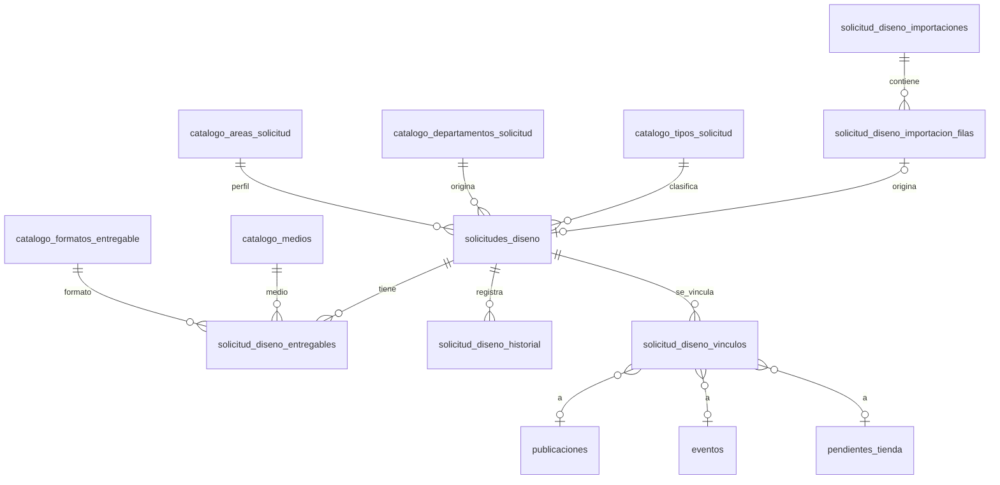

# Plan de datos y seguridad: solicitudes de Diseño

**Estado (2026-10-26):** propuesta para revisión; ajustado por D-21 (vínculo formal diferido, `referencia_manual` en la v1). Ningún objeto de este documento existe en `main` ni en Supabase. Los nombres de tablas, columnas, funciones y permisos son **propuestas**; los fragmentos SQL de §13 son ilustrativos y no están aprobados. Etiquetas de evidencia: ver [`plan-solicitudes-diseno.md` §0](./plan-solicitudes-diseno.md#0-cómo-leer-este-documento).

Contexto funcional en [`plan-solicitudes-diseno.md`](./plan-solicitudes-diseno.md). Mapeo de la hoja en [`plan-importacion-solicitudes-diseno.md`](./plan-importacion-solicitudes-diseno.md).

## 1. Principios y evidencia de partida

| Hecho | Etiqueta | Fuente |
|---|---|---|
| Las tablas del dominio habilitan RLS, revocan todo a `anon` y `authenticated` y otorgan solo lo mínimo. | `[REPO]` | `202610060001_role_permission_policies.sql`, `202610100001_publication_workflow_archive.sql` |
| Los permisos se evalúan con `public.has_permission(text)` (`security definer`, lee `profiles` y `role_permissions`). | `[REPO]` | `202610050001_auth_roles_permissions.sql` |
| `admin` solo gestiona perfiles (`can_manage_access`); no hay permisos de negocio sembrados para `admin`. | `[REPO]` | misma migración; búsqueda de `role_permissions` por rol |
| Eventos e Interno escriben mediante RPC `security definer` con `set search_path = ''` que llaman a un helper `*_require(permiso)`; los helpers no se otorgan a `authenticated`. | `[REPO]` | `events_require` en `202610150001_events_schedule.sql` |
| Historiales con `tipo`, `anterior jsonb`, `nuevo jsonb`, `motivo`, `cambiado_por`, `cambiado_en` y un trigger que rechaza `UPDATE`/`DELETE`; el borrado en cascada se admite solo si el padre ya no existe. | `[REPO]` | `evento_historial`, `pendiente_tienda_historial` |
| `publicacion_estatus_historial` no tiene trigger de inmutabilidad en las migraciones; solo tiene `GRANT SELECT`. | `[REPO]` | `202610100001_publication_workflow_archive.sql` |
| Los conflictos de versión optimista usan `PT409` y no `40001`, porque PostgREST 14 reintenta `40001`. | `[REPO]` | `20261021030127_fix_postgrest_40001_retry_loop.sql` |
| `inventory_import_batches` **no se crea en ninguna migración**; la crea el script `supabase/imports/20261013_control_inventario_mercadeo.sql`. Columnas: `batch_key`, `source_name`, `imported_at`, `imported_rows`, `source_rows`. | `[REPO]` | script y `docs/supabase-schema-public.md` |
| `docs/supabase-schema-public.md` está desactualizado (no refleja `evento_drive_uploads` ni las columnas `diseno_*` de `eventos`). | `[REPO]` | `docs/supabase-db-migration.md` §19 |
| Migraciones aplicadas en remoto hasta `20261021030127`; `20261021030128` pendiente; `202610150001` sin `db pull`. | `[REPORTADO]` | `docs/design/README.md` |

Principios de diseño `[PROPUESTA]`:

1. Solo funciones `security definer` escriben; ningún privilegio de `INSERT/UPDATE/DELETE` a `authenticated`.
2. Misma convención de nombres de columnas en español y de historial que Eventos e Interno.
3. Texto con `CHECK` para estados y prioridad (como `eventos` y `pendientes_tienda`); tablas de catálogo solo para valores ampliables.
4. Conflictos de versión con `PT409`.
5. Migraciones aditivas: ninguna modifica tablas, enums ni funciones existentes.

## 2. Modelo relacional propuesto



## 3. Diccionario de datos

Convención: `*_original` guarda el texto tal como llegó; la columna normalizada es `NULL` cuando no hay equivalencia segura. `NN` = not null.

### 3.1 `solicitudes_diseno`

| Columna | Tipo | NN | Notas |
|---|---|---|---|
| `id` | `uuid` PK | sí | `gen_random_uuid()` |
| `titulo` | `text` | sí | de «Nombre de arte/flyer»; 1–200 caracteres |
| `objetivo` | `text` | no | de «¿Qué se quiere lograr con esta pieza?» |
| `alcance_original` | `text` | no | texto original de piezas/alcance cuando no se pudo desglosar |
| `origen` | `text` | sí | `KROMI` o `IMPORTACION` |
| `importacion_fila_id` | `uuid` FK → `…_importacion_filas` | no | único; `NN` si `origen = 'IMPORTACION'` |
| `solicitante_usuario_id` | `uuid` FK → `auth.users` | no | solo si la coincidencia es verificable |
| `solicitante_nombre_original` | `text` | no | «Responsble»; no se sobrescribe |
| `departamento_id` | `uuid` FK → catálogo | no | `NULL` si no hay equivalencia |
| `departamento_original` | `text` | no | |
| `area_id` | `uuid` FK → catálogo | no | origen/perfil (Digital, Eventos, Interno, Gerencia…) |
| `area_original` | `text` | no | |
| `tipo_id` | `uuid` FK → catálogo | no | tipo de solicitud; ver D-17 sobre su derivación |
| `prioridad` | `text` | no | `CHECK in ('URGENTE','IMPORTANTE','NORMAL')`; `NULL` si la hoja no la trae |
| `prioridad_original` | `text` | no | |
| `solicitada_en_original` | `timestamptz` | no | «Marca temporal»; ver import §5 |
| `fecha_objetivo` | `date` | no | «Fecha de entrega» = fecha objetivo general `[CONFIRMADA]` |
| `fecha_objetivo_original` | `text` | no | |
| `estado` | `text` | sí | `CHECK in ('HISTORICA','ABIERTA','EN_CURSO','COMPLETADA','CANCELADA')` |
| `estado_historico_original` | `text` | no | «Estatus»; solo antecedente |
| `fecha_termino_historica` | `date` | no | «Fecha de termino»; solo antecedente `[CONFIRMADA]` |
| `fecha_termino_original` | `text` | no | |
| `ejecutor_historico_nombre` | `text` | no | «Diseñador» original; D-16 |
| `ejecutor_historico_usuario_id` | `uuid` FK → `auth.users` | no | solo si verificable |
| `responsable_actual_id` | `uuid` FK → `auth.users` | no | operativo; `NULL` en filas importadas |
| `referencias_originales` | `text` | no | «Imagen referencial» tal cual |
| `referencias_urls` | `text[]` | no | solo URLs `http(s)` extraídas; nunca se descargan |
| `referencia_manual` | `text` | no | referencia en texto a una publicación u otra entidad; sustituye al vínculo formal en la v1 (D-21) |
| `requiere_revision` | `boolean` | sí | default `false` |
| `motivos_revision` | `text[]` | sí | default `'{}'` |
| `motivo_cierre` | `text` | no | cancelación o cierre manual; obligatorio en esos casos |
| `version` | `integer` | sí | default 1; bloqueo optimista |
| `creado_en`, `creado_por` | `timestamptz`, `uuid` | sí / no | operativos; en filas importadas son la fecha de importación y el actor del lote |
| `modificado_en`, `modificado_por` | `timestamptz`, `uuid` | sí / no | |
| `archivado_en` | `timestamptz` | no | **no** se incluye en v1 (D-18); listada por si se aprueba |

Deliberadamente **ausentes**: fechas de solicitud a Diseño, inicio, entrega real o cierre operativo, SLA y cualquier derivada del SLA `[CONFIRMADA]`.

### 3.2 `solicitud_diseno_entregables`

| Columna | Tipo | NN | Notas |
|---|---|---|---|
| `id` | `uuid` PK | sí | |
| `solicitud_id` | `uuid` FK → `solicitudes_diseno` `ON DELETE RESTRICT` | sí | |
| `orden` | `smallint` | sí | único por solicitud |
| `pieza` | `text` | sí | nombre de la pieza; por defecto el título de la solicitud |
| `categoria` | `text` | no | `CHECK in ('DIGITAL','IMPRESO')` o `NULL` |
| `formato_id` / `formato_original` | `uuid` FK / `text` | no | «¿Qué se publica?» o «¿Qué se imprime?» |
| `medio_id` / `medio_original` | `uuid` FK / `text` | no | «¿A que medio pertenece?» |
| `cantidad_piezas` | `integer` | no | `CHECK > 0`; solo si es numérica y confiable |
| `cantidad_formatos` | `integer` | no | `CHECK > 0` |
| `alcance_texto` | `text` | no | texto original de alcance |
| `material` | `text` | no | «En qué material» |
| `medidas` | `text` | no | «Definir las medidas» |
| `fecha_objetivo` | `date` | no | propia; `NULL` hereda la de la solicitud en lectura |
| `estado` | `text` | sí | `CHECK in ('HISTORICO','PENDIENTE','EN_CURSO','COMPLETADO','CANCELADO')` |
| `completado_en` | `timestamptz` | no | operativo; `NULL` en `HISTORICO` |
| `datos_adicionales` | `jsonb` | sí | default `'{}'`; especificaciones originales sin columna propia |
| `version`, `creado_en`, `creado_por`, `modificado_en`, `modificado_por` | | | como arriba |

### 3.3 `solicitud_diseno_historial`

Misma forma que `evento_historial` `[REPO]`:

| Columna | Tipo | Notas |
|---|---|---|
| `id` | `uuid` PK | |
| `solicitud_id` | `uuid` FK `ON DELETE CASCADE` | el trigger solo admite borrado si el padre ya no existe |
| `entregable_id` | `uuid` FK → entregables `ON DELETE RESTRICT`, nullable | nulo en eventos de la solicitud completa; los entregables no se borran físicamente (D-19) |
| `tipo` | `text` | `CHECK in ('CREACION','EDICION','ESTADO','ASIGNACION','ENTREGABLE','VINCULO','IMPORTACION','DISENO')` |
| `anterior`, `nuevo` | `jsonb` | no nulos |
| `motivo` | `text` | `≤ 300` caracteres |
| `cambiado_por` | `uuid` FK → `auth.users` `ON DELETE SET NULL` | nulo = sistema |
| `cambiado_en` | `timestamptz` | |

`DISENO` solo se usa si se aprueba la integración (D-12).

### 3.4 `solicitud_diseno_vinculos`

> **Diferida (D-21):** la v1 usa solo `referencia_manual`. Esta tabla se crea cuando se apruebe un selector de publicación; hasta entonces no entra en las migraciones.

| Columna | Tipo | Notas |
|---|---|---|
| `id` | `uuid` PK | |
| `solicitud_id` | `uuid` FK | |
| `publicacion_id` / `evento_id` / `pendiente_id` | `uuid` FK nullable | `CHECK (num_nonnulls(...) = 1)` |
| `vinculado_por`, `vinculado_en` | `uuid`, `timestamptz` | |
| `motivo` | `text` | |
| `desvinculado_en`, `desvinculado_por` | | desvincular no borra: marca |

Unicidad parcial: un destino activo por solicitud y entidad. Se eligen tres FK anulables en lugar de una referencia polimórfica para conservar integridad referencial `[PROPUESTA]`.

### 3.5 Catálogos

Tablas `catalogo_tipos_solicitud`, `catalogo_departamentos_solicitud`, `catalogo_areas_solicitud`, `catalogo_medios`, `catalogo_formatos_entregable`, todas con: `id uuid` PK, `codigo text` único, `nombre text`, `activo boolean`, `orden smallint`, `alias text[]` (variantes que usa el importador), `creado_en`.

### 3.6 Importación

`solicitud_diseno_importaciones` (lote): `id`, `clave_lote text` único, `archivo_nombre`, `archivo_sha256`, `hoja`, `filas_origen`, `modo` (`SIMULACION`/`REAL`), `estado` (`EN_CURSO`/`COMPLETADO`/`FALLIDO`/`REVERTIDO`), `iniciado_en/por`, `finalizado_en`, `resumen jsonb`.

`solicitud_diseno_importacion_filas`: `id`, `lote_id` FK, `hoja`, `fila_origen integer`, `huella text`, `datos_originales jsonb` (las 22 columnas, tal cual), `resultado text`, `advertencias jsonb`, `errores jsonb`, `solicitud_id uuid` FK nullable, `creado_en`. Resultados en import §9.

## 4. Relaciones y cardinalidades

| Relación | Cardinalidad | Borrado |
|---|---|---|
| Lote → filas | 1:N | `RESTRICT` |
| Fila → solicitud | 1:0..1 | `RESTRICT` |
| Solicitud → entregables | 1:N (0..n) | `RESTRICT` |
| Solicitud → historial | 1:N | cascada solo si el padre ya no existe |
| Solicitud → vínculos | 1:N | `RESTRICT` |
| Vínculo → publicación/evento/pendiente | N:1 | `RESTRICT`; las entidades existentes ya archivan en vez de borrar |
| Catálogo → solicitud/entregable | 1:N | `RESTRICT`; los catálogos se desactivan, no se borran |

No se prevé borrado físico de solicitudes en la primera versión; se archiva (D-18).

## 5. Claves, restricciones e índices recomendados

| Objeto | Definición `[PROPUESTA]` |
|---|---|
| `uq_import_fila_origen` | `unique (lote_id, hoja, fila_origen)` |
| `idx_import_huella` | índice no único por `huella` para detectar duplicados entre lotes |
| `uq_solicitud_fila` | `unique (importacion_fila_id)` donde no es nulo |
| `ck_solicitud_origen` | `(origen = 'IMPORTACION') = (importacion_fila_id is not null)` |
| `ck_solicitud_cierre` | `estado in ('CANCELADA') → motivo_cierre is not null` |
| `ck_historica_sin_operativo` | `estado = 'HISTORICA' → responsable_actual_id is null` |
| `uq_entregable_orden` | `unique (solicitud_id, orden)` |
| `idx_solicitudes_estado_objetivo` | `(estado, fecha_objetivo)` |
| `idx_solicitudes_responsable` | `(responsable_actual_id) where estado in ('ABIERTA','EN_CURSO')` |
| `idx_solicitudes_departamento` | `(departamento_id)` |
| `idx_solicitudes_solicitante` | `(solicitante_usuario_id)` |
| `idx_entregables_solicitud` | `(solicitud_id, estado)` |
| `idx_historial_solicitud` | `(solicitud_id, cambiado_en desc)` |
| `uq_vinculo_activo` | únicos parciales por (`solicitud_id`, destino) donde `desvinculado_en is null` |

La detección de duplicados por similitud de título se hace en el importador (código), no en la base: así no se depende de `pg_trgm` `[PENDIENTE]` (verificar si la extensión está disponible solo si se decide moverla a SQL).

## 6. Estrategia de catálogos

| Dominio | Catálogo funcional | Enum o texto técnico existente | Decisión |
|---|---|---|---|
| Tipos de solicitud | `catalogo_tipos_solicitud` | — | Nuevo; ampliable `[CONFIRMADA]`. Valores iniciales: D-17. |
| Departamentos | `catalogo_departamentos_solicitud` | `departamento_enum` (5 valores, es del inbox de terceros) | Catálogo propio; el enum no se toca `[CONFIRMADA]`. |
| Áreas/perfiles | `catalogo_areas_solicitud` | roles de acceso (`social-media`, `internal`, `events`) | Catálogo propio; «Digital» identifica el perfil de Social Media pero no implica publicación `[CONFIRMADA]`. |
| Medios | `catalogo_medios` | — | Nuevo (Digital, Impreso; «Digital e impreso» se resuelve en dos entregables o categoría mixta, ver import §8). |
| Formatos | `catalogo_formatos_entregable` | `formato_enum` de publicaciones | Catálogo propio; `formato_enum` es editorial. |
| Estados | texto con `CHECK` | `estatus_enum` (editorial) | No reutilizar `[CONFIRMADA]`. |
| Prioridad | texto con `CHECK` | `publicaciones.prioridad` (smallint 1/2/3) | No reutilizar (D-05). |

El valor original siempre se conserva en la columna `*_original`. Los alias del catálogo sirven al importador; una coincidencia por alias es exacta tras normalizar (minúsculas, sin tildes, sin espacios sobrantes) y no usa similitud difusa.

## 7. Estados y transiciones del entregable

Estado del entregable `[PROPUESTA]` (D-04, D-10). Las transiciones de la solicitud están en [`plan-solicitudes-diseno.md` §8](./plan-solicitudes-diseno.md#8-estados-y-transiciones).

| Desde \ Hacia | PENDIENTE | EN_CURSO | COMPLETADO | CANCELADO |
|---|---|---|---|---|
| (nuevo) | ✓ | — | — | — |
| HISTORICO | ✓ reabrir (motivo) | — | — | — |
| PENDIENTE | — | ✓ | ✓ | ✓ (motivo) |
| EN_CURSO | ✓ | — | ✓ | ✓ (motivo) |
| COMPLETADO | ✓ reabrir (motivo) | ✓ reabrir (motivo) | — | — |
| CANCELADO | ✓ reabrir (motivo) | — | — | — |

Reglas: cada transición genera historial `tipo = 'ENTREGABLE'`; `completado_en` se fija al pasar a `COMPLETADO` y se anula al reabrir (el historial conserva la fecha previa); ninguna transición toca `HISTORICO` salvo «reabrir»; estas reglas son propuestas nuevas, no acordadas.

## 8. Tratamiento de valores originales y auditoría

**Valores originales.** Doble copia: (1) `datos_originales jsonb` en la fila de importación, con las 22 columnas sin tocar; (2) pares `*_original` en la solicitud y el entregable para lo que se consulta con frecuencia. Ningún valor normalizado sustituye al original.

**Datos personales.** El correo del solicitante («Dirección de correo electrónico») se conserva solo en `datos_originales` y en la resolución de identidad (D-14). No se expone en listados ni en el contrato de Diseño.

**Referencias externas.** «Imagen referencial» puede contener enlaces a Drive u otros sitios. Riesgos: enlaces privados o muertos, contenido ajeno al control de Kromi, redirecciones a sitios no confiables, y exposición de archivos si se mostraran incrustados. Reglas: se guarda como texto; solo se extraen URLs `http(s)`; no se descargan, no se previsualizan, no se modifican permisos de Drive; en la interfaz se muestran como enlaces con `rel="noopener noreferrer"` y una indicación de enlace externo.

**Auditoría.** `solicitud_diseno_historial` es el único registro de cambios. Los triggers de inmutabilidad se copian del patrón de `evento_historial`. Las filas importadas generan un solo evento `IMPORTACION` (lote y fila) y ningún evento de estado `[CONFIRMADA]`. La aplicación no edita lotes ni filas de importación una vez `COMPLETADO` (solo se agregan lotes nuevos); la única excepción es la función de reversión propuesta en D-20, exclusiva de `service_role`.

## 9. Matriz de permisos

Todos los permisos son **nuevos** `[PROPUESTA]`, bajo el prefijo `design.` que ya admite `AppPermission` (`design.${string}`) `[REPO]`, sin cambiar el tipo. Los roles de la columna «Concesión inicial» son una propuesta pendiente de D-07 y D-08; ningún permiso se concede a `admin` ni a roles sin necesidad funcional.

| Permiso | Operación | Concesión inicial propuesta | Alcance de lectura / condición de escritura | Validación en servidor | Validación en base de datos | Historial | Datos de importación |
|---|---|---|---|---|---|---|---|
| `design.solicitudes.read` | Listar y ver solicitudes y entregables | `design` | Todas (D-08) | `authorizeAction` antes de cualquier consulta | Política `SELECT` con `has_permission` | No | No |
| `design.solicitudes.create` | Crear solicitud nueva | `design` (D-08) | Solo `origen = 'KROMI'` | `authorizeAction`; no acepta `origen` del cliente | RPC con `*_require`; fija `origen` | Escribe `CREACION` | No |
| `design.solicitudes.update` | Editar campos | `design` | No sobre `HISTORICA` salvo reabrir; versión obligatoria | `authorizeAction`; valida versión | RPC valida estado, versión (`PT409`) | Escribe `EDICION` | No |
| `design.solicitudes.assign` | Asignar o reasignar responsable | `design` (D-07) | Solo `ABIERTA`/`EN_CURSO` | `authorizeAction` | RPC; verifica que el destino sea usuario con rol `design` | Escribe `ASIGNACION` | No |
| `design.solicitudes.status` | Cambiar estado de solicitud o entregable | `design` | Según matrices de §7 y del documento funcional §8 | `authorizeAction` | RPC valida transición y motivo | Escribe `ESTADO` / `ENTREGABLE` | No |
| `design.solicitudes.history.read` | Consultar historial | `design` | Solo de solicitudes que el usuario puede leer | `authorizeAction` | Política `SELECT` con `has_permission` | Sí | No |
| `design.solicitudes.link` | Vincular con publicación/evento/pendiente | `social-media` (publicaciones) y `design` (D-08) | Además exige el permiso de lectura de la entidad destino y, en publicaciones, acceso a todas sus cuentas (`user_has_all_publication_accounts`) | `authorizeAction` + comprobación del destino | RPC valida ambos permisos | Escribe `VINCULO` | No |
| `design.solicitudes.import.read` | Ver lotes, filas y datos originales | Ninguno por defecto; concesión explícita (D-09) | Lotes y filas | `authorizeAction` | Sin privilegios de tabla; solo RPC | No | Sí |
| `design.solicitudes.import.run` | Ejecutar o simular importación | Ninguno por defecto; concesión explícita (D-09) | — | `authorizeAction`; el cliente admin solo se usa tras autorizar | Funciones de importación solo `service_role` | Escribe `IMPORTACION` | Sí |
| `design.solicitudes.catalogs.manage` | Administrar catálogos | `design` (D-08) | Catálogos | `authorizeAction` | RPC | Opcional | No |
| (sin permiso) `admin` | — | — | `admin` no hereda nada | — | — | — | — |

## 10. Diseño de RLS y operaciones privilegiadas

1. **Tablas.** `ENABLE ROW LEVEL SECURITY`; `REVOKE ALL … FROM anon, authenticated`; `GRANT SELECT` solo en solicitudes, entregables, historial y catálogos, con políticas basadas en `has_permission`. Cero privilegios de escritura. Lotes y filas de importación: sin ningún privilegio para `authenticated`; acceso solo por RPC con `design.solicitudes.import.read`. Sin políticas permisivas (`using (true)`), ni siquiera temporales `[CONFIRMADA]`.
2. **Escrituras.** Funciones `security definer`, `set search_path = ''`, que llaman a un helper `design_solicitudes_require(permiso)` (no otorgado a `authenticated`), validan estado, versión y alcance, escriben historial en la misma transacción y se otorgan solo a `authenticated` (revocadas a `public` y `anon`), igual que las RPC de Eventos `[REPO]`.
3. **Server Actions.** Cada acción llama a `authorizeAction(permiso)` antes de usar cualquier cliente. El cliente administrativo (`getSupabaseAdmin`, Service Role, omite RLS) se reserva a la importación y a Drive, y nunca recibe `origen`, `estado` ni identidades del cliente sin validar `[REPO]` (patrón de `src/app/actions/solicitudes/convert.ts`).
4. **Importación.** Funciones de escritura masiva exclusivas de `service_role`; el actor del lote se registra como dato, no como permiso implícito.
5. **Contrato unificado de Diseño.** En v1 no hay adaptador, por lo que no existe acceso indirecto. Si D-12 aprueba la integración, la RPC de cola debe exigir `design.requests.read` **y** `design.solicitudes.read`, devolver solo los campos del contrato (§11 del documento funcional) y excluir `datos_originales`, correo y `estado_historico_original`.
6. **Conflictos de versión.** `raise sqlstate 'PT409'` `[REPO]`.

## 11. Impacto potencial sobre tablas y funciones existentes

| Elemento existente | Impacto en v1 |
|---|---|
| `publicaciones`, `pendientes_tienda`, `eventos` y sus historiales | Ninguno. Los vínculos son FK desde la tabla nueva. |
| `solicitudes_terceros`, `departamento_enum`, `estatus_enum`, `formato_enum` | Ninguno. |
| `get_design_*`, `design_*`, `request_*_to_design` | Ninguno. |
| `src/lib/designRequests.ts`, `src/app/actions/design/requests.ts` | Ninguno en v1; en F7 (si se aprueba) se extiende `DesignSource`, `VALID_SOURCES`, `sourceState` y las vistas de cola e historial. |
| `app_permissions`, `role_permissions` | Filas nuevas por migración aditiva. |
| `src/app/(dashboard)/design/shell.tsx` | Único archivo de UI existente que se edita: un ítem de menú (§11.1 del plan funcional, D-21). |
| `UnifiedQueueView.tsx`, `UnifiedHistoryView.tsx`, `DesignWorkspaceNav.tsx`, ficha única, `fieldRules.ts`, `DesignBadges.tsx` | Ninguno; no se amplían `DesignSource` ni `DesignStatus` en la v1. |
| `src/types/database.types.ts` | Se regenera tras la migración. |
| `docs/supabase-schema-public.md` y `.png` | Ya desactualizados; regenerar desde el remoto reconciliado (comprobación pendiente `[REPO]`). |
| `AGENTS.md` | Next.js con cambios incompatibles: leer `node_modules/next/dist/docs/` antes de escribir cualquier código de interfaz o acciones (aplica desde F4). |
| Convención de nombres de migración | Hay versiones de 12 y 14 dígitos; usar 14 dígitos para las nuevas. |

## 12. Objetos remotos que requieren comprobación antes de crear migraciones

Ninguno está verificado en remoto `[PENDIENTE]`:

1. Lista de migraciones aplicadas (`supabase migration list --linked`) frente a los 25 archivos de `supabase/migrations/`; confirmar si `20261021030128` se aplicó.
2. `supabase db pull` y diferencia con `202610150001_events_schedule.sql` en adelante.
3. Que no existan ya objetos con los nombres propuestos (`solicitudes_diseno`, `solicitud_diseno_*`, `catalogo_*`, `design_solicitudes_require`).
4. Filas reales de `app_permissions` y `role_permissions` (colisión con `design.solicitudes.*` y concesiones actuales por rol).
5. Existencia, `security definer` y grants de `has_permission`, `has_role`, `user_has_all_publication_accounts`, `events_require`.
6. `set_publication_design_requirement` y su trigger (pendiente en el README de diseño).
7. Estructura real de `inventory_import_batches` (no hay migración que la cree) y que no sea reutilizada.
8. Disponibilidad de `pg_trgm` solo si se decide mover la detección de duplicados a SQL.
9. Privilegios por defecto sobre tablas nuevas en `public`: `supabase/config.toml` deja `auto_expose_new_tables` sin definir `[REPO]`, y su comentario indica que el valor por defecto en la nube es `true`, es decir, una tabla nueva queda accesible a `anon`, `authenticated` y `service_role` sin `GRANT` explícito. Cada migración nueva debe habilitar RLS y hacer `REVOKE ALL … FROM anon, authenticated` en la misma transacción que crea la tabla (como hacen las migraciones actuales), y hay que confirmar el valor efectivo del proyecto remoto.

## 13. Fragmentos ilustrativos (no aprobados)

Solo para mostrar el patrón; no son una migración.

```sql
-- PROPUESTA: patrón de inmutabilidad (copia del de evento_historial)
create or replace function public.guard_solicitud_diseno_historial()
returns trigger language plpgsql set search_path = '' as $$
begin
  if tg_op = 'DELETE'
     and not exists (select 1 from public.solicitudes_diseno s where s.id = old.solicitud_id) then
    return old;
  end if;
  raise exception 'El historial de la solicitud no se puede editar ni eliminar.';
end; $$;

-- PROPUESTA: fila importada sin responsable operativo
alter table public.solicitudes_diseno
  add constraint ck_historica_sin_operativo
  check (estado <> 'HISTORICA' or responsable_actual_id is null);
```

## 14. Decisiones adicionales surgidas en este documento

Las decisiones D-16 a D-19 (ejecutor histórico sin responsable actual, valores iniciales del catálogo de tipos, archivado lógico y no borrado de entregables) están registradas en [`plan-solicitudes-diseno.md` §13.2](./plan-solicitudes-diseno.md#132-propuestas-y-pendientes), que es el único registro de decisiones.
