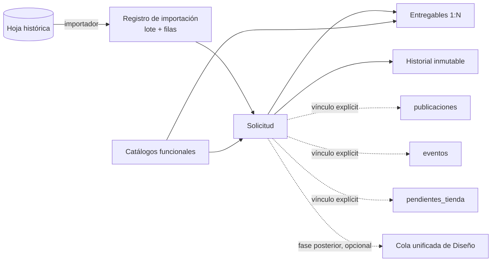
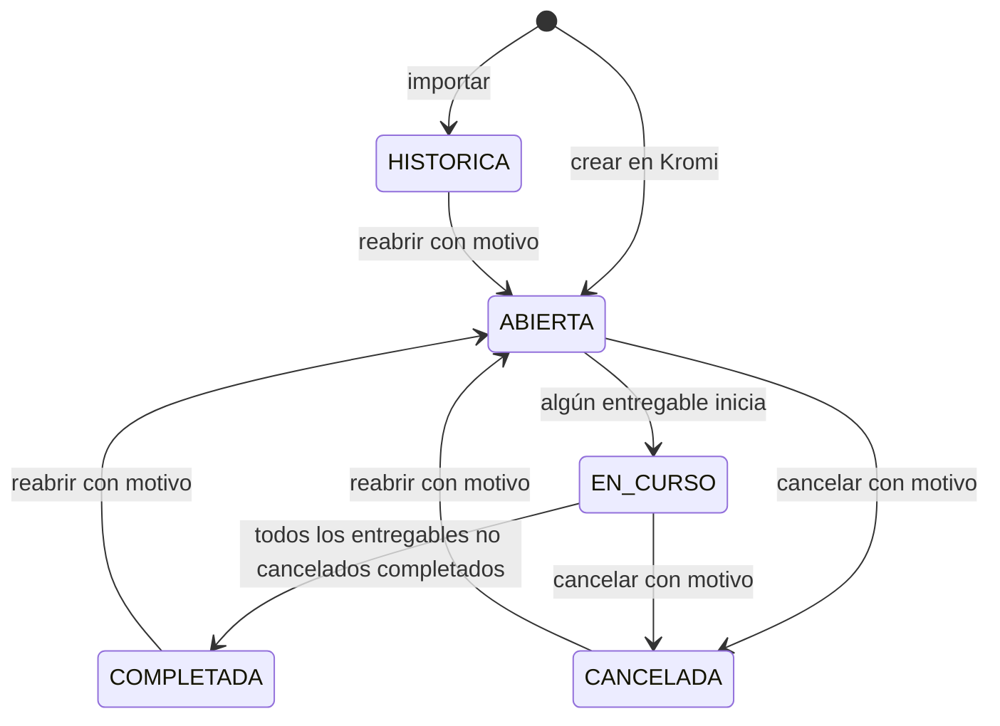

# Plan: módulo de solicitudes de Diseño (histórico y operativo)

**Estado (2026-10-26):** propuesta para revisión; se añadió §11.1 (restricciones de UI). Solo documentación; no hay código, migración ni importación. Todo lo no marcado como confirmado es una propuesta que requiere aprobación.

Documentos relacionados: modelo de datos y seguridad en [`plan-datos-solicitudes-diseno.md`](./plan-datos-solicitudes-diseno.md), mapeo e importación en [`plan-importacion-solicitudes-diseno.md`](./plan-importacion-solicitudes-diseno.md), fases y pruebas en [`roadmap-solicitudes-diseno.md`](./roadmap-solicitudes-diseno.md).

## 0. Cómo leer este documento

Etiquetas de evidencia y de decisión usadas en los cuatro documentos:

| Etiqueta | Significado |
|---|---|
| `[REPO]` | Verificado en el código o en una migración de `main` (commit `22d2fb1` al auditar). |
| `[REPORTADO]` | El usuario indicó que se aplicó en Supabase. No hay consulta directa. |
| `[REMOTO]` | Evidencia directa y actual del proyecto remoto. **Ninguna afirmación de estos documentos tiene esta etiqueta**: la sesión de auditoría no tuvo acceso de lectura a Supabase. |
| `[PENDIENTE]` | No hay evidencia suficiente. |
| `[CONFIRMADA]` | Decisión funcional ya acordada con el usuario (viene del encargo, §7). |
| `[PROPUESTA]` | Diseño nuevo recomendado, no aprobado. |

La hoja histórica **no estaba disponible** durante la auditoría. Todo lo que se dice de sus datos procede de las observaciones del análisis previo y debe revalidarse contra el archivo original (ver [`plan-importacion-solicitudes-diseno.md` §1](./plan-importacion-solicitudes-diseno.md#1-fuente)).

## 1. Problema y objetivos

Diseño recibe solicitudes de varias áreas y, hasta ahora, parte del registro vive en una hoja de cálculo (~264 solicitudes candidatas entre julio y octubre de 2026, según el análisis previo). Esa información no es consultable, no distingue entregables y mezcla campos categóricos con texto libre.

Objetivos:

1. Conservar el registro histórico con trazabilidad por fila y sin perder los valores originales.
2. Permitir gestionar solicitudes nuevas con varios entregables, responsable actual e historial auditable.
3. No obligar a que cada solicitud sea una publicación, un pendiente de tienda o un evento.
4. Integrarse con Diseño solo cuando haya una decisión funcional que lo justifique.

## 2. Alcance y exclusiones

**Incluido** `[CONFIRMADA]`: gestión estructurada de solicitudes; importación controlada; normalización con preservación del original; múltiples entregables; estados independientes (solicitud y entregable); historial; solicitante histórico y usuario vinculado opcional; responsable actual con auditoría de asignaciones; prioridad controlada; fechas históricas y objetivo; catálogos ampliables; detección de duplicados para revisión manual; registro de filas importadas, excluidas y rechazadas; vinculación futura y explícita con publicaciones; compatibilidad con la cola unificada de Diseño cuando exista contrato y autorización.

**Fuera de alcance inicial** `[CONFIRMADA]`: aprobaciones formales; conversión automática a publicaciones; WhatsApp; notificaciones y recordatorios; automatizaciones de seguimiento; cambios al flujo editorial de Social Media; reemplazo de las tablas de Interno o Eventos; reescritura de adaptadores de Diseño no necesaria; cambios en la hoja original; importación directa a producción sin validación previa.

**Riesgos fuera de alcance, para fases futuras** `[PROPUESTA]`: notificar por email al recibir solicitudes nuevas (hoy es una idea abierta en [`backlog-roadmap.md`](../backlog-roadmap.md), «Registro de solicitudes»); recibir solicitudes de otras áreas por un formulario propio en lugar de Google Forms (decisión «fuente de verdad» abierta en el mismo backlog, filas «Registro de solicitudes (Diseño)»).

## 3. Arquitectura recomendada (resumen)

**Entidad independiente + relaciones explícitas.** Una solicitud (`solicitudes_diseno`) con entregables 1:N, historial inmutable, catálogos funcionales y un registro de importación por lote y fila. Sin tabla física que sustituya a `publicaciones`, `pendientes_tienda` o `eventos`. La vinculación con esas entidades es una acción explícita mediante una tabla de vínculos. La integración con la cola de Diseño **no entra en el primer despliegue**.

Alternativas evaluadas (detalle en §13, D-01):

| Alternativa | Veredicto |
|---|---|
| Cargar todo en `publicaciones` | Descartada `[CONFIRMADA]`: su ciclo editorial, cuentas sociales y SLA no aplican; `estatus_enum` es editorial `[REPO]`. |
| Cargar todo en `pendientes_tienda` | Descartada `[CONFIRMADA]`: exige `sede_id` y `creado_por` `[REPO]`; el histórico no siempre tiene tienda. |
| Crear eventos artificiales | Descartada `[CONFIRMADA]`. |
| Reutilizar `solicitudes_terceros` | Descartada `[PROPUESTA]`: es el inbox de terceros que se convierte en publicación; `departamento_emisor` es `departamento_enum` de 5 valores `[REPO]` y su `estatus_solicitud` es texto libre con valores de convención (`RECHAZADO`, `CONVERTIDA`). Mezclar ciclos de vida rompería `processRequestAction`. |
| Una sola tabla de solicitud sin entregables | Descartada: no soporta finalización parcial ni formatos por pieza `[CONFIRMADA]`. |
| **Solicitud + entregables + historial + importación (elegida)** | Recomendada `[PROPUESTA]`: integridad referencial, auditoría compatible con el patrón existente, coste de mantenimiento moderado. |

## 4. Actores y permisos funcionales

Los permisos concretos y la matriz completa están en [`plan-datos-solicitudes-diseno.md` §9](./plan-datos-solicitudes-diseno.md#9-matriz-de-permisos). A nivel funcional:

| Actor | Rol de acceso `[REPO]` | Necesidad funcional `[PROPUESTA]` |
|---|---|---|
| Diseño | `design` | Consultar, gestionar estado de entregables, ver historial. Quién asigna responsables: pendiente (D-07). |
| Social Media | `social-media` | Consultar y vincular solicitudes con publicaciones (acción explícita). Alcance por cuentas: pendiente (D-08). |
| Interno, Eventos | `internal`, `events` | Sin acceso en la primera versión salvo decisión expresa (D-08). |
| Gerencia, Atención al cliente | `management`, `customer-support` | Sin acceso; no tienen permisos de negocio definidos `[REPO]`. |
| Administrador | `admin` | **No** hereda acceso: el rol `admin` solo administra perfiles (`can_manage_access`) y no tiene permisos de negocio sembrados en las migraciones `[REPO]`. Ejecutar la importación requiere un permiso propio (D-09). |

## 5. Entidades y relaciones conceptuales

| Concepto | Entidad propuesta | Notas |
|---|---|---|
| Solicitud | `solicitudes_diseno` | Requerimiento original; fecha objetivo general; estado operativo; responsable actual. |
| Entregable | `solicitud_diseno_entregables` | 1:N; estado y fecha objetivo propios; formato y medio; cantidades separadas del texto de alcance. |
| Historial | `solicitud_diseno_historial` | Mismo patrón que `evento_historial` y `pendiente_tienda_historial` (`tipo`, `anterior`, `nuevo`, `motivo`, actor, fecha). Incluye asignaciones. |
| Vínculo | `solicitud_diseno_vinculos` (diferida, D-21) | A `publicaciones`, `eventos` o `pendientes_tienda`; exactamente un destino por fila. En la v1 solo existe `referencia_manual` en la solicitud. |
| Catálogos | tablas `catalogo_*` | Tipos de solicitud, departamentos, áreas, medios y formatos. Estados y prioridad: texto con `CHECK` (D-04, D-05). |
| Importación | `solicitud_diseno_importaciones` y `…_importacion_filas` | Lote y fila con dato original y resultado. |

Cardinalidades, claves y restricciones en el documento de datos §3–§6. Nombres de tablas y columnas son propuestas; ninguno existe en el repositorio.

## 6. Campos y catálogos

El diccionario completo está en [`plan-datos-solicitudes-diseno.md` §3](./plan-datos-solicitudes-diseno.md#3-diccionario-de-datos). Reglas funcionales:

1. Toda columna categórica normalizada tiene su par `*_original` de texto que conserva lo que dijo la hoja `[CONFIRMADA]`.
2. Un valor sin equivalencia en el catálogo deja la columna normalizada en `NULL` y el original intacto; nunca se fuerza `OTRO`.
3. Descripciones, objetivo, material y medidas son texto `[CONFIRMADA]`.
4. No se amplía `departamento_enum` ni `estatus_enum` `[CONFIRMADA]`. El análisis de compatibilidad está en D-03.
5. Una nueva solicitud creada en Kromi Connect usa los mismos catálogos; el catálogo crece con una acción administrativa, sin migración.

## 7. Gestión de solicitudes y entregables

**Solicitud.** Se crea con título, objetivo, solicitante (usuario o nombre), departamento, área, prioridad y fecha objetivo general. Tiene un responsable actual cuando la operación lo requiere. Puede existir sin publicación y sin Diseño `[CONFIRMADA]`.

**Entregables.** Una solicitud tiene cero o más. Cada combinación de pieza y formato es un entregable; varios formatos equivalentes de la misma pieza pueden agruparse solo cuando la interpretación sea inequívoca `[CONFIRMADA]`. Cada entregable guarda: pieza, categoría, formato original y normalizado, medio original y normalizado, `cantidad_piezas`, `cantidad_formatos`, `alcance_texto`, material, medidas, fecha objetivo propia y estado propio. Se separan cantidad de piezas, cantidad de formatos y texto de alcance porque no son equivalentes `[CONFIRMADA]`.

**Prioridad.** `URGENTE`, `IMPORTANTE`, `NORMAL` `[CONFIRMADA]`; pertenece a la solicitud. Prioridad por entregable: no se incluye en la primera versión (D-05). No se reutiliza la escala de `publicaciones.prioridad` (ver §13, D-05).

**Fechas.** Distinguir fecha original de la hoja, fecha objetivo y fechas operativas de Kromi Connect `[CONFIRMADA]`. El detalle y la zona horaria están en el documento de importación §5.

## 8. Estados y transiciones

Cuatro conceptos distintos `[CONFIRMADA]`, no mezclar:

| Concepto | Dónde vive | Notas |
|---|---|---|
| Estado histórico importado | `estado_historico_original` (texto) | Antecedente. Nunca se traduce automáticamente. |
| Estado operativo de la solicitud | `estado` | Propuesta de valores abajo. |
| Estado del trabajo de Diseño | **no existe en esta entidad** en v1 | Solo aparecería si se aprueba la integración (§11). |
| Estado del entregable | `estado` del entregable | Propuesta abajo. |

**Valores propuestos** `[PROPUESTA]` (D-04):

- Solicitud: `HISTORICA`, `ABIERTA`, `EN_CURSO`, `COMPLETADA`, `CANCELADA`.
- Entregable: `HISTORICO`, `PENDIENTE`, `EN_CURSO`, `COMPLETADO`, `CANCELADO`.

`HISTORICA`/`HISTORICO` significa «proviene de la hoja y no tiene ciclo operativo en Kromi Connect». Evita traducir «Terminado» a `COMPLETADA` y evita simular que hubo transiciones. Una solicitud histórica puede reabrirse explícitamente (ver reglas).

**Reglas de consistencia** `[PROPUESTA]`:

1. R1. El estado de la solicitud se almacena (no se calcula en la lectura), pero lo actualiza una función de servidor que lo valida contra los entregables en la misma transacción.
2. R2. `EN_CURSO` si hay al menos un entregable `EN_CURSO` o `COMPLETADO` y alguno `PENDIENTE` o `EN_CURSO`. La finalización parcial queda visible por los entregables; no hay estado `PARCIAL`.
3. R3. `COMPLETADA` solo si todos los entregables no cancelados están `COMPLETADO` y existe al menos uno. Una solicitud sin entregables no pasa a `COMPLETADA` automáticamente; se completa manualmente con motivo (D-10).
4. R4. Cancelar la solicitud exige motivo; los entregables abiertos pasan a `CANCELADO` en la misma transacción y los completados se conservan.
5. R5. Reabrir exige motivo, deja la solicitud en `ABIERTA` y no modifica entregables `COMPLETADO` ni `CANCELADO` salvo acción explícita sobre cada uno.
6. R6. Cancelar o completar un entregable no cambia por sí solo la solicitud a `CANCELADA`; solo R2/R3 la mueven.
7. R7. Las transiciones «reabrir» y «cancelar» son propuestas nuevas, no acordadas; los criterios de cierre quedan pendientes de aprobación (D-10).

Matriz completa de transiciones del entregable en el documento de datos §7.

## 9. Historial y auditoría

- Toda transición de estado, cambio relevante de campo y asignación genera una fila en `solicitud_diseno_historial` `[CONFIRMADA]`.
- La importación **no** genera filas de transición; registra un único evento `IMPORTACION` con referencia al lote y fila `[CONFIRMADA]`.
- Reasignación: `tipo = 'ASIGNACION'`, con responsable anterior y nuevo, actor y fecha `[CONFIRMADA]`.
- El historial es inmutable para usuarios ordinarios: sin privilegios de escritura directa y con un trigger que rechaza `UPDATE` y `DELETE`, igual que `evento_historial` y `pendiente_tienda_historial` `[REPO]`.
- Hallazgo `[REPO]`: `publicacion_estatus_historial` se protege solo retirando privilegios de escritura; las migraciones no definen un trigger equivalente. No se debe tomar como modelo.

## 10. Vinculación futura con publicaciones

- Acción explícita y autorizada `[CONFIRMADA]`; nunca automática por departamento, área o medio.
- Vínculo formal opcional en `solicitud_diseno_vinculos` (una fila por destino), **diferido** según D-21: la v1 usa solo `referencia_manual`. La primera importación puede dejar solo una referencia manual en texto `[CONFIRMADA]`; no se crean vínculos formales al importar.
- Crear una publicación **a partir de** una solicitud (conversión) es una acción distinta y posterior; debe reutilizar `createPostWithDriveAction` y respetar los permisos y el alcance por cuentas de `publicaciones`. No se diseña en esta fase (D-11).
- El vínculo no copia estados ni fechas entre entidades.

## 11. Integración con Diseño

Contrato actual `[REPO]`: `DesignSource = 'SOCIAL_MEDIA' | 'INTERNAL' | 'EVENTS'`; `DesignRequest` con `requested_outputs`, `design_status` (`REQUESTED`, `IN_PROGRESS`, `NEEDS_CHANGES`, `DELIVERED`, `CANCELLED`) y adaptadores `adaptPublication`, `adaptInternal`, `adaptEvent` en `src/lib/designRequests.ts`. Las acciones de Design se despachan por origen en `src/app/actions/design/requests.ts` y cada RPC valida `design.requests.*` o su permiso de origen.

**Recomendación** `[PROPUESTA]` (D-12): **no integrar en el primer despliegue.** Razones:

1. Las solicitudes históricas están terminadas o canceladas en su gran mayoría; no deben generar tickets activos.
2. Un cuarto origen obliga a tocar `DesignSource`, `VALID_SOURCES`, `sourceState`, las rutas `/design/requests/[source]/[id]`, `fieldRules.ts` y las vistas de cola e historial.
3. La vía de menor impacto ya existe: **vincular** la solicitud a una publicación, evento o pendiente que sí aparece en la cola. Diseño ve el trabajo por su origen habitual y la solicitud sigue siendo el registro de negocio.

Si más adelante se aprueba un origen propio, condiciones mínimas:

| Pregunta | Propuesta |
|---|---|
| Elegibilidad | Solo solicitudes con estado `ABIERTA` o `EN_CURSO`, con al menos un entregable `PENDIENTE` que requiera Diseño y con acción explícita «Enviar a Diseño». Nunca `HISTORICA`. |
| Campos comunes | `title`, `requested_by`, `requested_at`, `instructions` (objetivo), `target_date`, `requested_outputs` (derivado de entregables), `usage_date`. |
| Estado de Diseño | Columna propia en la solicitud o en el entregable, separada de `estado`. Valores alineados con `DesignStatus`. |
| Historial de Diseño | El mismo `solicitud_diseno_historial`, con `tipo = 'DISENO'`. |
| Permisos | Un adaptador y RPC propios que validen `design.requests.read` más un permiso de la nueva entidad; la RPC no devuelve datos de importación ni identidades históricas. |
| Duplicados | Índice único parcial: una sola solicitud de Diseño activa por entregable. |
| Cancelación | Cancelar la solicitud cancela el trabajo de Diseño abierto y registra motivo (alineado con `guard_event_design_archive`). |
| Entregas | Los archivos entregados se asocian al entregable por `drive_file_id`; no se copian a la solicitud. |

### 11.1 Restricciones de UI e integración mínima `[PROPUESTA]` (D-21, D-22)

**Principio:** integración sencilla. No se añaden pasos, modales ni vistas que no sean necesarios, y el diseño ya aplicado en las vistas existentes no cambia.

**Punto de partida verificado en el repositorio `[REPO]`:**

- El menú de Diseño se define en `src/app/(dashboard)/design/shell.tsx`: un grupo «Diseño» con un único ítem, **Solicitudes** (`/design/publications`), que ya es la cola unificada. `DesignWorkspaceNav.tsx` muestra las pestañas Solicitudes e Historial.
- El menú de Social Media se define en `src/app/(dashboard)/social-media/SocialMediaLayoutClient.tsx` (Efemérides, Campañas, Calendario de contenido y otros). Los menús por rol se inyectan con `useRegisterShellSlots` (`src/app/(dashboard)/components/ShellSlot.tsx`).
- «Solicitudes» ya nombra dos cosas: la cola de Diseño y el inbox de terceros de Social Media (`/social-media/requests`). El módulo nuevo necesita otro nombre.
- `DesignStatusBadge` y `OriginChip` (`design/components/DesignBadges.tsx`) están tipados con `DesignStatus` y `DesignSource` de `src/lib/designRequests.ts`.

**Alcance de UI propuesto para la v1:**

| Elemento | Propuesta |
|---|---|
| Entrada | **Un solo ítem nuevo** en el menú de Diseño, con nombre distinto de «Solicitudes» (por aprobar; p. ej. «Registro»). Ítem en otro rol solo si D-08 le concede lectura. |
| Vistas | **Una sola vista nueva**: listado con los filtros mínimos y paginación como las vistas de Diseño. Sin página de ficha aparte. |
| Detalle | **Dentro de la misma vista**, expandiendo la fila: entregables, historial y datos originales. Sin modales. |
| Acciones | En la fila expandida: estado del entregable, responsable y referencia manual. Sin formularios en modal. |
| Vínculo con publicaciones | Solo **referencia manual en texto** en la v1, como ya permite la decisión confirmada de §7.1 del encargo. El selector de publicación y la tabla de vínculos se difieren; se evita así un modal y cualquier control nuevo en Grid. |
| Crear solicitudes desde la interfaz | Pendiente (D-22). Recomendación: no incluirlo en la v1 hasta decidir el canal de entrada (backlog: «Registro de solicitudes (Diseño)»). |

**Lo que no se toca `[PROPUESTA]`** (se verifica en cada revisión de código con `git diff --stat`):

- `design/publications/UnifiedQueueView.tsx`, `design/publications/history/UnifiedHistoryView.tsx`, `design/publications/DesignWorkspaceNav.tsx`.
- La ficha única: `design/requests/[source]/[id]/*` y `src/lib/design/fieldRules.ts`.
- `src/lib/designRequests.ts` (no ampliar `DesignSource` ni `DesignStatus`), `src/lib/designSla.ts` y `design/components/DesignBadges.tsx`. Para los estados nuevos se usa un chip propio con el mismo estilo; no se pasan valores nuevos a `DesignStatusBadge`.
- Los modales de Grid y Kanban, y las vistas de Interno y Eventos.

**Único archivo existente que se edita:** `design/shell.tsx`, para añadir el ítem de menú (más el equivalente de otro rol si D-08 lo aprueba).

**Cómo construirlo sin alterar el diseño:**

1. Ruta nueva dentro de `/design`, en una carpeta nueva (p. ej. `design/registro/`, por aprobar), que hereda el layout actual.
2. Reutilizar sin modificar: `useRegisterShellSlots`, los tokens de color y la fuente documentados en [`README.md`](./README.md#cómo-leer-los-prototipos), y `formatDesignDate`/`getCaracasToday` de `designSla.ts` (formato `es-VE`, zona `America/Caracas`).
3. Leer la guía de `node_modules/next/dist/docs/` antes de escribir código, como exige `AGENTS.md`.
4. **Verificación visual:** capturar la cola, el historial y la ficha de Diseño y el menú de Social Media **antes** de empezar y compararlos al terminar; la única diferencia admitida es el ítem de menú nuevo. Playwright está configurado (`playwright.config.ts`, `e2e/`), pero el repositorio no tiene pruebas de capturas hoy `[REPO]`; hay que crear la línea base.

Esto sustituye cualquier idea de listado, ficha y formulario separados. Si más adelante el equipo pide una ficha propia, se decide aparte.

## 12. Criterios de aceptación

Funcionales (verificables tras implementar):

1. Una solicitud sin publicación, sin entregables y sin Diseño se crea, consulta y cancela.
2. Una solicitud con tres entregables completa uno y las demás siguen abiertas; la solicitud queda `EN_CURSO`.
3. Cambiar de responsable crea una fila `ASIGNACION` con anterior, nuevo, actor y fecha, y no altera `solicitante_*`.
4. Intentar `UPDATE` o `DELETE` sobre el historial falla incluso con `service_role`.
5. Ninguna solicitud `HISTORICA` aparece en la cola de Diseño.
6. Un usuario sin permiso no lee solicitudes, historial ni datos de importación, por vía de tabla ni de RPC.
7. Los estados históricos se leen tal cual en `estado_historico_original` y no existen filas de historial con transiciones anteriores a la importación.
8. (UI, si se aprueba D-21) Ninguna vista existente de Diseño, Social Media, Interno ni Eventos cambia respecto de la línea base de capturas, salvo el ítem de menú nuevo; el módulo no usa modales ni páginas de ficha aparte.

De documentación: los 14 criterios del encargo se comprobaron en la revisión cruzada de [`roadmap-solicitudes-diseno.md` §9](./roadmap-solicitudes-diseno.md#9-revisión-cruzada-de-la-documentación).

## 13. Registro de decisiones

### 13.1 Confirmadas (resumen)

Las decisiones funcionales del encargo (§7) y las arquitectónicas (§4.1) se conservan sin cambios. Las que condicionan el diseño: solicitud ≠ publicación; vinculación explícita; catálogos ampliables con valor original; no ampliar `departamento_enum` ni `estatus_enum`; entregables con estado propio; estados históricos preservados sin traducir; importación sin transiciones simuladas ni SLA automático; `Responsble` = solicitante; `Fecha de entrega` = fecha objetivo general; `Fecha de termino` solo antecedente; duplicados a revisión manual; fila sin marca temporal ni título excluida; idempotencia; `admin` sin acceso automático.

### 13.2 Propuestas y pendientes

| ID | Decisión | Estado | Contexto | Alternativas | Recomendación | Consecuencias | Evidencia para cerrar |
|---|---|---|---|---|---|---|---|
| D-01 | Entidad independiente con entregables | Propuesta | Ver §3. | Extender entidades existentes; tabla única | Entidad independiente + vínculos | Nuevas tablas y RPC; más superficie de RLS | Aprobación del usuario |
| D-02 | Conciliar esquema remoto antes de migrar | Propuesta (obligatoria) | `[REPORTADO]` aplicadas hasta `20261021030127`; `20261021030128` pendiente; `202610150001` sin `db pull`. | `db push` directo | `supabase db pull` + `migration list --linked` antes de F2 | Bloquea F2 | Salida de ambos comandos revisada |
| D-03 | Catálogo propio de departamentos en vez de `departamento_enum` | Propuesta | El enum tiene 5 valores (`COMPRAS`, `SELECCION`, `PROVEEDOR`, `GERENCIA`, `EVENTOS`) y solo cubre 2 de los 8 departamentos observados en la hoja (Compras y Selección); faltan Mercadeo, Farmacia, Capital Humano, Ventas Online, Operaciones Perecederos y Seguridad Laboral. Ver import §6.3. | Ampliar el enum | Tabla `catalogo_departamentos_solicitud` | Sin migraciones de enum al crecer | Revisión de la lista real de departamentos |
| D-04 | Estados como texto con `CHECK`, valores de §8 | Propuesta | Eventos y pendientes usan texto con `CHECK` `[REPO]`; el enum de publicaciones es editorial. | Enum nuevo; tabla de estados | Texto + `CHECK` | Cambiar valores requiere migración | Aprobación de valores y de `HISTORICA` |
| D-05 | Prioridad `URGENTE/IMPORTANTE/NORMAL` como texto; no reutilizar `publicaciones.prioridad` | Propuesta | Esa escala es `smallint` 1 Alta, 2 Normal, 3 Baja (default 2) `[REPO]`; «Urgente» no tiene equivalente y «Importante» tampoco; el contrato de Diseño usa `HIGH/NORMAL/LOW`. | Reutilizar y mapear | Texto propio; mapeo a `HIGH/NORMAL/LOW` solo si se integra | Sin reinterpretar datos | Decidir mapeo si hay integración |
| D-06 | Historial único con `tipo` (incluye asignaciones) | Propuesta | Patrón existente en eventos y pendientes. | Tabla de asignaciones aparte | Una tabla | Menos objetos | Aprobación |
| D-07 | Quién asigna y reasigna responsables | Pendiente | El encargo no lo define. | Solo `design`; cualquier usuario con permiso | Rol `design` con permiso propio | Define la matriz | Respuesta del usuario |
| D-08 | Qué roles leen solicitudes y con qué alcance | Pendiente | `social-media`, `internal`, `events` pueden ser solicitantes. | Solo `design`; lectura de las propias | Lectura global para `design`; resto sin acceso en v1 | Define RLS | Respuesta del usuario |
| D-09 | Cómo se ejecuta la importación y con qué permiso | Pendiente | Precedente: `supabase/imports/20261013_control_inventario_mercadeo.sql` (script SQL manual) `[REPO]`. | UI administrativa; script de línea de comandos | Script de servidor con permiso propio, simulación primero; UI no necesaria | Define F3/F5 | Respuesta del usuario |
| D-10 | Criterios de cierre, reapertura y cancelación | Pendiente | El encargo pide definirlos; R1–R7 son propuesta. | Solo cancelar | R1–R7 de §8 | Define transiciones | Aprobación |
| D-11 | Conversión solicitud → publicación | Pendiente (fase futura) | Acordada como acción explícita; diseño no definido. | Solo vínculo manual | Diferir a una fase posterior | Fuera de v1 | Decisión de fase |
| D-12 | Integración con la cola de Diseño | Propuesta: diferir | Ver §11. | Integrar en v1 | Diferir; vincular a entidades existentes | Diseño no ve solicitudes históricas | Aprobación |
| D-13 | Estado operativo de una solicitud importada | Propuesta | No traducir estados históricos. | Mapear a estados actuales | `HISTORICA` | Reabrir requiere acción | Aprobación |
| D-14 | Visibilidad del correo del solicitante | Pendiente | El correo es dato personal `[PENDIENTE]`. | Guardarlo solo en la fila de importación | Solo en la fila de importación y en la resolución de identidad | Reduce exposición | Aprobación |
| D-15 | Zona horaria de la marca temporal importada | Pendiente | Zona del propietario del formulario sin confirmar. | UTC; Caracas | `America/Caracas` (UTC−04) si se confirma | Cambia `timestamptz` importadas | Confirmar con el archivo y el propietario |
| D-16 | «Diseñador» de la hoja es identidad histórica del ejecutor; no crea responsable actual ni evento `ASIGNACION` al importar | Propuesta | Se busca no simular asignaciones que no ocurrieron en Kromi Connect. | Crear responsable actual desde la hoja | Guardar `ejecutor_historico_*` y dejar `responsable_actual_id` nulo | Reabrir exige asignar | Aprobación |
| D-17 | Valores iniciales del catálogo de tipos de solicitud y su derivación | Pendiente | La hoja no tiene una columna de tipo; `Área`, medio y campos de publicación/impresión solo lo sugieren. | Derivar el tipo automáticamente; dejarlo nulo en lo importado | Tipo nulo en filas importadas; catálogo definido con el usuario para solicitudes nuevas | Evita clasificar por intuición | Lista de tipos acordada |
| D-18 | Archivado lógico de solicitudes | Propuesta: no incluir en v1 | Las solicitudes canceladas o terminadas siguen consultables `[CONFIRMADA]`. | Añadir `archivado_en` | Diferir | Sin papelera para esta entidad | Decisión de alcance |
| D-19 | Los entregables no se borran físicamente | Propuesta | Preserva historial y trazabilidad. | Borrado en cascada | Cancelar en lugar de borrar; FK `RESTRICT` | Corrección de errores de captura vía cancelación | Aprobación |
| D-20 | Reversión de un lote importado | Pendiente | Hace falta un camino de vuelta atrás si la importación real sale mal; el borrado libre choca con D-19 y con la inmutabilidad del historial. | Sin reversión (solo restaurar un respaldo); función de reversión | Función exclusiva de `service_role`, solo para lotes sin actividad posterior (import §14, punto 8) | Una función privilegiada más que probar | Aprobación y prueba en entorno no productivo |
| D-21 | Alcance mínimo de UI de la v1 (§11.1) | Propuesta | Evitar alterar el diseño aplicado en Diseño, Social Media, Interno y Eventos, y no añadir pasos, modales ni vistas innecesarios. | Listado + ficha + formularios propios; integrar dentro de la cola de Diseño | Un ítem de menú, una vista con detalle expandible, sin modales, sin tocar vistas existentes | La v1 es más austera; una ficha propia queda como mejora posterior | Aprobación; nombre del ítem y de la ruta |
| D-22 | Crear solicitudes nuevas desde la interfaz en la v1 | Pendiente | El canal de entrada actual (Google Forms) sigue abierto en el backlog; el encargo incluye gestionar, no fija la creación desde UI. | Incluir creación inline; solo consultar y gestionar lo importado | Diferir la creación hasta decidir el canal de entrada | Si se difiere, el criterio 1 de §12 se limita a lo importado y a la base de datos | Decisión del usuario sobre el canal de entrada |

Rechazadas: ninguna hasta ahora.
