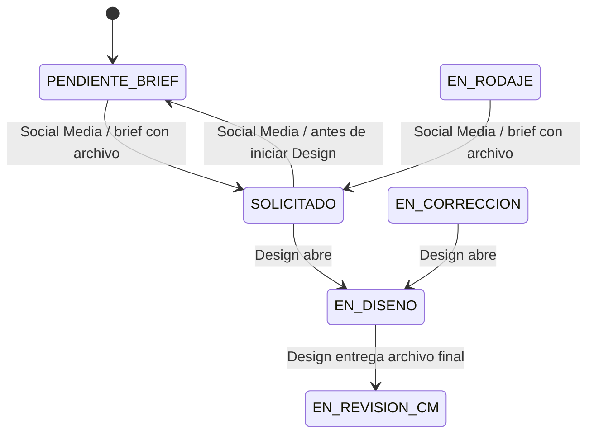

# Plan de implementación: brief con Drive y retorno reversible

**Estado (2026-10-12):** la carga/listado del Brief, la solicitud validada y la vista de archivos para Design están implementadas localmente. El usuario reportó aplicadas `202610110001_publication_brief_drive_uploads.sql` y la migración 110002 de la opción sin Design, y compartió comprobaciones parciales de sus objetos. Falta confirmar específicamente `set_publication_design_requirement` y su trigger. El OAuth y la conexión se probaron en `/api/test-connections`; la carga resumible desde el dominio desplegado requiere validación propia.
**Alcance:** publicaciones de `/social-media/grid`, acciones de servidor, Google Drive y transición al flujo de Design.
**Base revisada:** repositorio y migraciones locales hasta `202610110002_publication_design_requirement.sql`; esquema remoto solo según evidencia compartida por el usuario.

## 1. Resultado esperado

Social Media puede completar el brief desde Kromi Connect, consultar sus archivos y enviar la solicitud a Design solo cuando exista al menos un archivo de brief. Si todavía no empezó el trabajo de diseño, puede devolver `SOLICITADO` a `PENDIENTE_BRIEF`, completar archivos y volver a solicitar. Design debe comprobar los entregables finales por separado de los assets del brief.

El sistema debe conservar la auditoría de cada ciclo. Los campos de fechas del registro representan el ciclo vigente; `publicacion_estatus_historial` conserva la fecha, actor y transición de las solicitudes anteriores. Al devolver a Brief se limpian `fecha_solicitud_diseno` y `fecha_entrega_diseno_estimada`; la fecha límite del brief permanece.

## 2. Hallazgos del código actual que condicionan el plan

- `workflow.ts` ya valida en servidor que Design no entregue sin un archivo en Drive. `hasPublicacionDeliverable()` busca cualquier archivo no carpeta en la carpeta raíz.
- `transition_publicacion_status` permite `SOLICITADO` desde `PENDIENTE_BRIEF` y `EN_RODAJE`, pero no valida Drive; la RPC es ejecutable por `authenticated`.
- `StatusSelect.tsx` ofrece `SOLICITADO` desde esos dos estados. No ofrece retorno a `PENDIENTE_BRIEF`.
- La RPC fija `fecha_solicitud_diseno` y la estimación solo si no existían previamente; al re-solicitar no actualiza esos campos para el nuevo ciclo. La fecha límite del brief sí se recalcula.
- La creación genera una carpeta principal de Drive. No hay acciones para subir o listar archivos.
- Los archivos de brief y la pieza entregada compartirían la misma carpeta con el planteamiento inicial. Esto no es seguro funcionalmente: una referencia del brief contaría como pieza final para la validación actual de Design.
- `transition_publicacion_status` **no tiene `PENDIENTE_BRIEF` como destino desde ningún estado**: solo permite `PENDIENTE_BRIEF → EN_RODAJE`. El retorno `SOLICITADO → PENDIENTE_BRIEF` es una transición nueva, y `EN_RODAJE → PENDIENTE_BRIEF` tampoco existe hoy.
- La carpeta padre (`GOOGLE_DRIVE_PARENT_FOLDER_ID`) está en **Mi unidad**, no en una unidad compartida (confirmado por el equipo). La cuenta de servicio no resolvía el almacenamiento; OAuth con la cuenta personal del equipo ya permitió una subida de prueba desde `/api/test-connections` (sección 10, decisión 4).
- Vercel limita el cuerpo de una petición a una función a unos 4.5 MB. Un Route Handler con `multipart/form-data` no sirve para briefs con imágenes o video; se debe subir directo a Drive (sección 4).
- Las carpetas se crean con permiso `reader` para `anyone`. El equipo decidió mantener ese acceso: cualquiera que obtenga el enlace puede leer los briefs y entregables. Falta comprobar que las subcarpetas y archivos nuevos reciban el acceso previsto.

## 3. Decisiones recomendadas

1. **Separar contenidos en Drive:** cada carpeta de publicación tendrá subcarpetas `Brief` y `Entregables`. Social Media sube/lista archivos en `Brief`; Design entrega y valida archivos en `Entregables`. No contar archivos de una carpeta como contenido de la otra.
2. **No enviar archivos por Server Actions ni por el servidor de Vercel.** Decisión confirmada: carga **directa del navegador a Drive** mediante una sesión resumible que el servidor autoriza e inicia (sección 4). El servidor nunca recibe el contenido del archivo.
3. **La comprobación autoritativa ocurre en servidor en cada solicitud.** La acción autenticada consulta el contenido real de `Brief` en Drive inmediatamente antes de solicitar. El control de cliente solo mejora la UX.
4. **La transición estricta a `SOLICITADO` es exclusivamente de servidor.** La RPC genérica `transition_publicacion_status` no debe permitir que `authenticated` establezca ese destino. Crear una RPC específica, por ejemplo `request_publication_to_design(...)`, ejecutable solo por `service_role`. La acción valida la sesión, `social-media.posts.status.update` y el acceso a todas las cuentas; consulta Drive y actualiza el estado sincronizado mediante una función igualmente restringida. La RPC de servicio valida el actor pasado explícitamente contra roles/permisos y cuentas asignadas, el estado origen, el conteo positivo y `drive_brief_checked_at` con antigüedad máxima de 5 minutos. No usar `auth.uid()` para identificar al usuario final en una llamada `service_role`. Las columnas de sincronización quedan protegidas por grants/RLS y `guard_publicacion_workflow_columns`. Si se borran archivos directamente en Drive, la próxima solicitud vuelve a consultar Drive y corrige el conteo antes de transicionar.
5. **Permitir retorno solo desde `SOLICITADO`.** No permitir retorno desde `EN_DISENO`: al abrir la solicitud, Design ya empezó a trabajar y el estado debe reflejarlo. La RPC actual no tiene `PENDIENTE_BRIEF` como destino desde ningún estado, así que `SOLICITADO → PENDIENTE_BRIEF` se añade como transición nueva. `EN_RODAJE → PENDIENTE_BRIEF` queda fuera según decisión confirmada.
6. **Fechas de ciclo (confirmado):** al volver de `SOLICITADO` a `PENDIENTE_BRIEF`, limpiar `fecha_solicitud_diseno` y `fecha_entrega_diseno_estimada`; conservar `fecha_limite_brief`, que depende de la fecha de publicación. El historial conserva el timestamp/actor de la solicitud anterior. En cada nueva transición a `SOLICITADO`, fijar otra vez `fecha_solicitud_diseno`, recalcular `fecha_limite_brief` y `fecha_entrega_diseno_estimada`. El historial actual no conserva el valor histórico de las fechas SLA; no se requiere esa instantánea en este alcance.
7. **Permisos y contenido:** carga/listado con permisos `social-media.posts.edit` / `social-media.posts.read`, además de verificación de alcance de todas las cuentas destino. Borrado de archivos fuera del MVP para no eliminar por accidente una pieza entregada; puede añadirse con confirmación y auditoría en una fase posterior.

## 4. Arquitectura funcional propuesta

### Drive

- Mantener la carpeta raíz existente por publicación.
- Añadir y persistir IDs de las subcarpetas `Brief` y `Entregables` (campos en `publicaciones` o tabla de metadatos Drive). La creación debe ser idempotente para cubrir publicaciones existentes y fallos parciales.
- Acciones servidor: asegurar estructura; listar archivos de Brief; subir a Brief; listar archivos de Entregables para Design; comprobar que Entregables tenga al menos un archivo.
- **Subida directa y resumible.** (1) El navegador pide iniciar una carga con UUID de publicación, nombre, MIME declarado y tamaño. (2) El servidor valida sesión, permiso y alcance de cuentas, reserva atómicamente uno de los 10 cupos de Brief, resuelve la carpeta y crea la sesión resumible en Drive; devuelve la URL de sesión como secreto temporal, sin guardarla en logs. (3) El navegador envía fragmentos con progreso, cancelación y manejo de reanudación. (4) Al terminar, una acción confirma en Drive padre, tamaño real y metadatos; libera/consume la reserva y actualiza el conteo sincronizado. No se acepta un `folderId` del navegador. La cancelación o expiración de una sesión libera su cupo. `Content-Length` lo gestiona el navegador; la aplicación no debe intentar fijarlo mediante Fetch.
- **Límites iniciales (decididos):** JPG, PNG, WebP, PDF y MP4; hasta 100 MB por archivo y 10 archivos presentes o reservados por Brief/publicación. Verificar extensión y metadatos MIME como política operativa; no se inspecciona la firma ni se escanea el contenido, por lo que esto no constituye protección antimalware. El tamaño se valida al iniciar y se contrasta con los metadatos finales de Drive.
- El visor MVP muestra lista de nombre, tipo, tamaño, fecha, thumbnail si está disponible y enlace para abrir en Drive. No requiere preview embebido ni descarga proxy en Kromi. No se exponen credenciales OAuth ni de cuenta de servicio.
- MVP no implementa eliminación de archivos desde Kromi. La acción de solicitud y la de entrega vuelven a consultar sus subcarpetas respectivas en Drive.

### Flujo de estados

El resto de transiciones editoriales existentes no cambia. La ida a `PENDIENTE_BRIEF` registra una transición normal en historial, sin motivo obligatorio. Una nueva solicitud crea otra entrada `SOLICITADO` y renueva los campos del ciclo actual.

## 5. Plan por fases

### Fase 0 — Privacidad, inventario y contrato de archivos

- **Cuenta de almacenamiento: resuelta y verificada** con OAuth mediante `/api/test-connections` (sección 10, decisión 4). La prueba de conexión/subida no sustituye la prueba de carga resumible directa desde el navegador.
- Privacidad: decidido mantener el permiso `anyone: reader`. Documentar que cualquiera con el enlace puede leer briefs y entregables.
- No migrar ni clasificar archivos sueltos en las carpetas raíz. Identificar publicaciones actualmente en `EN_DISENO` o `EN_CORRECCION` y coordinar el movimiento manual de sus piezas a `Entregables`.
- Límites, privacidad y viewer inicial ya están decididos. Validar en el dominio real las peticiones resumibles desde el navegador: CORS/preflight, encabezados permitidos/expuestos, progreso, reanudación y cancelación.

**Salida:** política de acceso y plan de clasificación sin mover/borrar archivos accidentalmente.

### Fase 1 — Esquema y servicios Drive

- Crear migración aditiva para IDs/estado sincronizado de Brief y para cualquier metadato operativo necesario.
- Crear/asegurar subcarpetas idempotentemente para publicaciones nuevas y existentes.
- Implementar listar archivos, iniciar la sesión resumible y confirmar la subida desde el servidor, autorizando sesión, permiso y acceso a cuentas.
- Persistir el resultado del chequeo de Brief en funciones ejecutables solo por `service_role`; proteger columnas y ampliar el trigger.
- Crear una RPC de transición a `SOLICITADO` solo para `service_role`, con validación explícita del actor; impedir ese destino desde la RPC genérica para `authenticated`.
- Mantener separada la verificación de entregables de Design, apuntándola a `Entregables`; aplicar el movimiento manual acordado a las piezas que ya están en diseño/corrección.
- Añadir reservas de carga con vencimiento y aplicación atómica del máximo de 10 archivos por publicación.

**Salida:** API de servidor segura y modelo de Drive compatible con publicaciones existentes.

### Fase 2 — UI de Brief y archivos

- Crear sección reusable de Brief con selección múltiple/drag and drop, progreso por archivo, cancelación y reanudación según soporte de la sesión, y errores recuperables. Los estados (vacío, subiendo, errores, listo, límite alcanzado y sin carpeta) ya están diseñados en el lienzo y en `modales-publicacion.md` (sección 3.1); los artboards están en `docs/design/prototypes/`.
- Añadir lista de archivos de Brief (nombre, tipo, tamaño, fecha y enlace para abrir en Drive; sin preview embebido en MVP).
- Integrarla en Crear después de crear la publicación/carpeta y en Editar/Detalle cuando exista publicación.
- Mostrar estado accesible “Faltan archivos” / “Brief listo” y cantidad/última comprobación. No permitir que el estado dependa únicamente de un hook local sin actualizar el servidor.
- No habilitar borrar en el MVP.

**Salida:** Social Media puede subir y revisar archivos sin salir de la aplicación, con mensajes de progreso y error claros.

### Fase 3 — Guardas del flujo y ciclo reversible

- En la acción servidor de transición a `SOLICITADO`: verificar autorización y alcance, consultar Drive en esa operación, actualizar el estado de Brief como `service_role` y llamar a la RPC específica de servicio; propagar errores claros y distinguir fallo de Drive de brief vacío.
- En SQL: bloquear `SOLICITADO` desde la RPC genérica autenticada. La RPC específica, ejecutable solo por `service_role`, debe comprobar actor, rol, permiso, alcance de cuentas, estado origen, conteo positivo y frescura máxima de 5 minutos.
- Añadir `SOLICITADO → PENDIENTE_BRIEF` en RPC y selector (`StatusSelect.tsx`), solo para Social Media y sin motivo. Es una transición nueva: hoy ningún estado tiene `PENDIENTE_BRIEF` como destino.
- Al retornar a `PENDIENTE_BRIEF`, limpiar `fecha_solicitud_diseno` y `fecha_entrega_diseno_estimada`, conservar `fecha_limite_brief` y registrar la transición en historial. En cada nueva solicitud, actualizar las tres fechas del ciclo vigente; el historial retiene las solicitudes anteriores.
- Design entrega solo cuando la subcarpeta `Entregables` contenga al menos un archivo; los archivos de `Brief` no cuentan.

**Salida:** tanto la UI como las entradas de servidor autorizadas respetan las reglas del flujo.

### Fase 4 — Operación y reconciliación

- Proveer una forma administrativa/operativa de volver a consultar Drive para reparar estado sincronizado si un archivo se elimina fuera de la aplicación.
- Registrar errores de subida/listado y mantener acciones reintentables sin duplicar publicación ni carpeta.
- Documentar variables/configuración, despliegue y límites de Drive.

**Salida:** errores recuperables sin depender de borrar/recrear publicaciones.

## 6. Matriz de permisos

| Acción | Rol/permiso | Chequeos adicionales |
|---|---|---|
| Subir/listar Brief | Social Media; `social-media.posts.edit` / `social-media.posts.read` | Publicación activa, todas las cuentas destino asignadas, carpeta resuelta en servidor |
| Iniciar y confirmar subida a Brief | Social Media; `social-media.posts.edit` | Mismos chequeos que subir; la confirmación revalida contra Drive |
| Solicitar a Design | Social Media; `social-media.posts.status.update` | Estado permitido, Brief verificado en Drive y conteo sincronizado positivo |
| Volver a Brief | Social Media; `social-media.posts.status.update` | Estado actual `SOLICITADO`; registrar historial |
| Listar/entregar pieza | Design; permisos existentes `design.posts.read` / `design.posts.deliver` | Solo cola Design; archivo en `Entregables` antes de entrega |
| Eliminar archivo | Fuera de alcance del MVP | Definir auditoría y evitar borrar entregable activo antes de habilitar |

Las acciones servidor deben validar el ID y no confiar en `folderId`, conteos ni nombres de carpeta enviados por el cliente. La garantía estricta depende de que `authenticated` no pueda llamar a la transición a `SOLICITADO`; el actor debe ser validado explícitamente por la RPC restringida a `service_role`.

## 7. Criterios de aceptación

1. Social Media puede subir varios archivos permitidos a Brief con progreso y errores claros; la operación no revela credenciales ni acepta carpetas arbitrarias.
2. La lista muestra metadatos disponibles y abre el archivo en Drive según permisos actuales; no se requiere preview embebido.
3. La tarjeta y los modales reflejan si hay archivos de Brief, respaldado por una consulta/sincronización de servidor.
4. Sin archivos, la UI explica por qué `SOLICITADO` no está disponible; la RPC genérica rechaza ese destino para `authenticated`, y la RPC de servicio falla sin evidencia reciente de archivos.
5. Con archivos de Brief, Social Media puede solicitar; las fechas del SLA corresponden a ese ciclo.
6. Desde `SOLICITADO`, Social Media puede volver a `PENDIENTE_BRIEF` con motivo opcional. Desde `EN_DISENO` o `EN_RODAJE` no puede hacerlo. El retorno limpia fechas del ciclo vigente según §3, decisión 6, y §10, decisión 5.
7. Al re-solicitar, las fechas actuales se renuevan y las transiciones anteriores siguen visibles en el historial.
8. Un archivo en Brief no satisface el requisito de entrega de Design; se requiere un archivo en Entregables.
9. Ninguna operación de fallo parcial duplica una publicación o crea subcarpetas duplicadas.
10. Una subida de prueba de un archivo de varios MB y de un video grande termina correctamente con la cuenta de almacenamiento elegida, sin pasar por el servidor de Vercel.
11. Un archivo cuya extensión/MIME no esté en la lista permitida, o que supere el tamaño máximo confirmado por Drive, es rechazado y no cuenta para el brief. La aplicación no afirma inspeccionar contenido ni detectar malware.
12. La acción vuelve a consultar Drive antes de toda solicitud. La RPC de servicio también rechaza un conteo de más de 5 minutos o cero archivos.

## 8. Migraciones de Supabase previstas

Sí, se requiere una nueva migración. Como mínimo debe:

- Añadir referencias/IDs de las subcarpetas y estado sincronizado de Brief (o tablas equivalentes).
- Restringir escritura directa de los metadatos de sincronización; añadir RPC/funciones con grants mínimos para actualizar el resultado consultado por el servidor.
- Modificar `transition_publicacion_status` para negar `SOLICITADO` a `authenticated`; añadir una RPC específica para solicitud ejecutable solo por `service_role`, con actor explícito y validación de roles/permisos/cuentas.
- Permitir retorno `SOLICITADO → PENDIENTE_BRIEF` en el flujo social; limpiar `fecha_solicitud_diseno` y `fecha_entrega_diseno_estimada` al retornar; fijar las fechas vigentes al solicitar nuevamente.
- Actualizar checks/policies/grants únicamente si las nuevas columnas o RPC lo requieren.
- No añadir estado al enum; ambos estados ya existen.

La migración no debe ejecutar llamadas HTTP a Google desde PostgreSQL. La acción de servidor realiza la lectura de Drive y Supabase aplica la condición sobre el estado sincronizado.

## 9. Fuera de alcance inicial

- Versionado de copy o assets, comentarios nuevos, asignación individual a Design.
- Borrado de archivos desde Kromi, salvo que se apruebe después con auditoría.
- Cambiar el permiso público de Drive sin decisión específica; mantenerlo requiere reconocer que cualquier persona con acceso al enlace puede leer los assets.
- Descarga proxy/streaming desde Kromi, edición online, archivos de más de 100 MB y sincronización bidireccional completa.

## 10. Decisiones

**Confirmadas (2026-10-11):**

1. **Subida:** directa del navegador a Drive mediante sesión resumible iniciada por el servidor.
2. **Privacidad:** se mantiene el permiso `anyone: reader` de las carpetas.
3. **Límites:** JPG, PNG, WebP, PDF y MP4; 100 MB por archivo y máximo 10 archivos presentes o reservados por Brief/publicación. La extensión y MIME son una validación operativa; no se escanea el contenido.
4. **Cuenta de almacenamiento:** OAuth con la cuenta personal de Drive del equipo (100 GB). Variables `GOOGLE_CLIENT_ID`, `GOOGLE_CLIENT_SECRET` y `GOOGLE_REFRESH_TOKEN`; `getDriveClient` las usa primero y conserva la cuenta de servicio como respaldo. La app de OAuth debe estar **En producción** (en modo Pruebas el refresh token caduca a los 7 días). **Verificado el 2026-10-11** con `/api/test-connections`: `authMode: oauth` y subida de prueba de 1 KB correcta.
5. **Retorno y fechas (confirmado):** solo `SOLICITADO → PENDIENTE_BRIEF`; sin retorno desde `EN_DISENO` ni desde `EN_RODAJE`. El motivo es **opcional**. Al volver se limpian `fecha_solicitud_diseno` y `fecha_entrega_diseno_estimada`; se conserva `fecha_limite_brief`. La entrada histórica conserva la fecha/actor del intento anterior. Al volver a solicitar se renuevan las fechas del ciclo vigente.
6. **Archivos ya existentes en carpetas raíz (confirmado):** las carpetas actuales mezclan pruebas y uso real y no tienen subcarpetas. Los archivos sueltos de raíz se **ignoran**; no se clasifican ni migran. Las subcarpetas se crean idempotentemente cuando se necesiten.
7. **Publicaciones antiguas ya en curso (confirmado):** el equipo mueve manualmente a `Entregables` las piezas sueltas de publicaciones en `EN_DISENO` o `EN_CORRECCION`; no se añade fallback en el código.
8. **Frescura del conteo (confirmado):** 5 minutos, como constante única en la función de base de datos. La acción vuelve a consultar Drive en cada intento.
9. **Seguridad de transición (confirmado):** solo la acción de servidor puede solicitar a Design. `authenticated` no puede establecer `SOLICITADO` mediante la RPC genérica; una RPC solo para `service_role` valida explícitamente al actor y su alcance.
10. **Visor (confirmado):** lista con metadatos y enlace para abrir en Drive; preview embebido queda fuera del MVP.

**Decisiones de producto pendientes:** ninguna. **Validaciones técnicas previas al despliegue:** CORS/preflight y encabezados de la carga desde el origen real; progreso/reanudación/cancelación; subida directa de un archivo de varios MB y un MP4 grande; permisos heredados de las subcarpetas/archivos OAuth; expiración y liberación de reservas de carga.

## 11. Implementación local (2026-10-11)

- Social Media tiene lista/carga de Brief en Crear, Editar y Detalle; Design consulta Brief y Entregables desde su cola existente.
- Las cargas usan sesiones Drive resumibles y fragmentos de 8 MiB, con progreso, reanudación (tras recargar se vuelve a seleccionar el mismo archivo), cancelación y cupos reservados en Supabase. Si falla la revocación, el cupo se conserva hasta vencer la sesión.
- `202610110001_publication_brief_drive_uploads.sql` y la migración 110002 están reportadas como aplicadas. Antes de usar el control «Requiere Design» en producción, confirmar que `set_publication_design_requirement` y `guard_publication_design_requirement` existen con los grants previstos.
- La compilación comprueba TypeScript y generación Next.js; no prueba la sintaxis/ejecución SQL contra el proyecto Supabase ni el CORS en el navegador de producción.
- La API Drive v3 documenta consulta/reanudación de sesiones, pero no documenta una operación de revocación; el cliente intenta `DELETE` y conserva el cupo cuando no obtiene confirmación.
- Las subcarpetas se localizan por nombre y se crean si no existen. La carga concurrente de carpetas debe verificarse en Drive para confirmar que no aparezcan duplicados.

## 12. Flujo opcional sin Design (2026-10-11)

Una publicación puede no requerir trabajo del rol Design. `publicaciones.requiere_diseno` usa `true` como valor predeterminado para conservar el flujo vigente. Social Media puede cambiarlo solo en `PENDIENTE_BRIEF` o `EN_RODAJE`; si la solicitud ya se envió, primero debe retirarla a Brief mientras Design no la haya abierto.

- Sin diseño y sin rodaje, Social Media puede pasar de `PENDIENTE_BRIEF` directamente a `PENDIENTE_APROBACION_GERENCIA`.
- Sin diseño y con rodaje, el recorrido es `PENDIENTE_BRIEF` → `EN_RODAJE` → `PENDIENTE_APROBACION_GERENCIA`.
- Aprobación, programación y publicación conservan las transiciones actuales. Social Media registra la aprobación externa.
- Brief, solicitud, entrega y SLA de Design se muestran como `No aplica`. Los archivos de Drive son opcionales y no habilitan ni bloquean el avance.
- Las publicaciones sin Design se excluyen de `get_design_publication_queue`; las RPC rechazan solicitar o ejecutar acciones de Design para ellas.
- La migración `202610110002_publication_design_requirement.sql` protege el cambio de la preferencia mediante una RPC autorizada y limita cuándo puede cambiarse.
