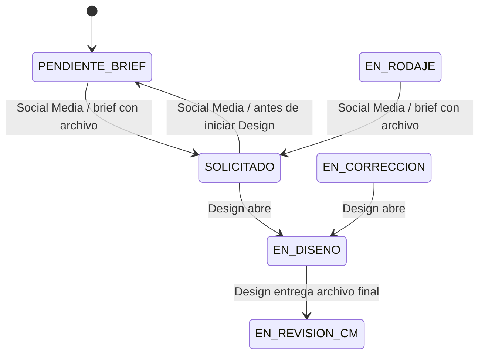

# Plan de implementación: brief con Drive y retorno reversible

**Estado:** propuesta revisada el 2026-10-11 con las decisiones del equipo (sección 10). Aún bloqueada por la cuenta de almacenamiento de Drive (sección 10, decisión 5). No modifica código ni base de datos.
**Alcance:** publicaciones de `/social-media/grid`, acciones de servidor, Google Drive y transición al flujo de Design.
**Base revisada:** el repositorio actual y `202610100001_publication_workflow_archive.sql`.

## 1. Resultado esperado

Social Media puede completar el brief desde Kromi Connect, consultar sus archivos y enviar la solicitud a Design solo cuando exista al menos un archivo de brief. Si todavía no empezó el trabajo de diseño, puede devolver `SOLICITADO` a `PENDIENTE_BRIEF`, completar archivos y volver a solicitar. Design debe comprobar los entregables finales por separado de los assets del brief.

El sistema debe conservar la auditoría de cada ciclo. Los campos de fechas del registro representan el ciclo vigente; `publicacion_estatus_historial` conserva las fechas/actores de las solicitudes anteriores.

## 2. Hallazgos del código actual que condicionan el plan

- `workflow.ts` ya valida en servidor que Design no entregue sin un archivo en Drive. `hasPublicacionDeliverable()` busca cualquier archivo no carpeta en la carpeta raíz.
- `transition_publicacion_status` permite `SOLICITADO` desde `PENDIENTE_BRIEF` y `EN_RODAJE`, pero no valida Drive; la RPC es ejecutable por `authenticated`.
- `StatusSelect.tsx` ofrece `SOLICITADO` desde esos dos estados. No ofrece retorno a `PENDIENTE_BRIEF`.
- La RPC fija `fecha_solicitud_diseno` y la estimación solo si no existían previamente; al re-solicitar no actualiza esos campos para el nuevo ciclo. La fecha límite del brief sí se recalcula.
- La creación genera una carpeta principal de Drive. No hay acciones para subir o listar archivos.
- Los archivos de brief y la pieza entregada compartirían la misma carpeta con el planteamiento inicial. Esto no es seguro funcionalmente: una referencia del brief contaría como pieza final para la validación actual de Design.
- `transition_publicacion_status` **no tiene `PENDIENTE_BRIEF` como destino desde ningún estado**: solo permite `PENDIENTE_BRIEF → EN_RODAJE`. El retorno `SOLICITADO → PENDIENTE_BRIEF` es una transición nueva, y `EN_RODAJE → PENDIENTE_BRIEF` tampoco existe hoy.
- La carpeta padre (`GOOGLE_DRIVE_PARENT_FOLDER_ID`) está en **Mi unidad**, no en una unidad compartida (confirmado por el equipo). Crear carpetas funciona, pero según la documentación de Google las cuentas de servicio no tienen cuota de almacenamiento: subir archivos a una carpeta de Mi unidad suele fallar con `storageQuotaExceeded`. Hay que resolverlo antes de implementar subidas (sección 10, decisión 5).
- Vercel limita el cuerpo de una petición a una función a unos 4.5 MB. Un Route Handler con `multipart/form-data` no sirve para briefs con imágenes o video; se debe subir directo a Drive (sección 4).
- Las carpetas se crean con permiso `reader` para `anyone`. Los archivos que se suban serán accesibles mediante ese permiso; el alcance de las carpetas debe tratarse como una decisión de privacidad.

## 3. Decisiones recomendadas

1. **Separar contenidos en Drive:** cada carpeta de publicación tendrá subcarpetas `Brief` y `Entregables`. Social Media sube/lista archivos en `Brief`; Design entrega y valida archivos en `Entregables`. No contar archivos de una carpeta como contenido de la otra.
2. **No enviar archivos por Server Actions ni por el servidor de Vercel.** Decisión confirmada: carga **directa del navegador a Drive** mediante una sesión resumible que el servidor autoriza e inicia (sección 4). El servidor nunca recibe el contenido del archivo.
3. **La comprobación autoritativa ocurre en servidor.** Antes de transicionar a `SOLICITADO`, una acción autenticada comprueba el contenido real de `Brief` en Drive. El control de cliente solo mejora la UX y no es una medida de seguridad.
4. **La RPC debe tener una condición verificable en base de datos.** Como PostgreSQL no consulta Google Drive, almacenar un estado de brief sincronizado por las operaciones de servidor (por ejemplo `drive_brief_file_count` y `drive_brief_checked_at`) y hacer que la RPC rechace la solicitud si no hay archivos. La acción refresca primero ese estado desde Drive. Las columnas no deben poder escribirse directamente por `authenticated`: se actualizan mediante una función ejecutable solo por `service_role`, que la acción llama con el cliente de administración (como ya hace `archive.ts`), y el trigger `guard_publicacion_workflow_columns` debe ampliarse para cubrirlas. Para acotar la obsolescencia, la RPC exige además que `drive_brief_checked_at` sea reciente (propuesta: 10 minutos), no solo `drive_brief_file_count > 0`. Si archivos se borran fuera de Kromi, el estado puede quedar obsoleto: la comprobación previa a solicitar y la reconciliación manual/operativa reducen ese riesgo.
5. **Permitir retorno solo desde `SOLICITADO` inicialmente.** No permitir retorno desde `EN_DISENO`: al abrir la solicitud, Design ya empezó a trabajar y el estado debe reflejarlo. La RPC actual no tiene `PENDIENTE_BRIEF` como destino desde ningún estado, así que `SOLICITADO → PENDIENTE_BRIEF` se añade como transición nueva. `EN_RODAJE → PENDIENTE_BRIEF` queda fuera salvo decisión contraria.
6. **Fechas de ciclo:** la RPC actual solo fija `fecha_solicitud_diseno` y la estimación cuando están vacías (`... is null`); esa condición debe cambiar para que cada paso a `SOLICITADO` renueve ambas. Al volver a solicitar, `fecha_solicitud_diseno`, `fecha_limite_brief` y `fecha_entrega_diseno_estimada` se actualizan para el nuevo ciclo. Las fechas/actores de solicitudes anteriores permanecen en `publicacion_estatus_historial`. Si el negocio requiere reconstruir también la fecha límite y estimación histórica, se deberá añadir una instantánea SLA al historial; la tabla actual no conserva esos valores por cada transición.
7. **Permisos y contenido:** carga/listado con permisos `social-media.posts.edit` / `social-media.posts.read`, además de verificación de alcance de todas las cuentas destino. Borrado de archivos fuera del MVP para no eliminar por accidente una pieza entregada; puede añadirse con confirmación y auditoría en una fase posterior.

## 4. Arquitectura funcional propuesta

### Drive

- Mantener la carpeta raíz existente por publicación.
- Añadir y persistir IDs de las subcarpetas `Brief` y `Entregables` (campos en `publicaciones` o tabla de metadatos Drive). La creación debe ser idempotente para cubrir publicaciones existentes y fallos parciales.
- Acciones servidor: asegurar estructura; listar archivos de Brief; subir a Brief; listar archivos de Entregables para Design; comprobar que Entregables tenga al menos un archivo.
- **Subida directa y resumible.** (1) El navegador pide a una acción de servidor iniciar la subida, indicando UUID de publicación, nombre, tipo MIME y tamaño. (2) El servidor valida sesión, permiso, acceso a todas las cuentas, tipo y tamaño permitidos, resuelve él mismo la subcarpeta `Brief` e inicia la sesión resumible de Drive con `Origin` del sitio para habilitar CORS; devuelve solo la URL de la sesión. (3) El navegador envía el archivo por fragmentos a esa URL, con progreso y cancelación. (4) Al terminar, el navegador llama a una acción de confirmación; el servidor vuelve a consultar Drive (`files.get`: padre, tipo, tamaño), rechaza o elimina lo que no cumpla y actualiza el conteo sincronizado. No se acepta un `folderId` enviado por el navegador.
- **Límites iniciales (decididos):** JPG, PNG, WebP, PDF y MP4; hasta 100 MB por archivo y 10 archivos por solicitud. Como el servidor no ve el contenido antes de la subida, el tipo se verifica después con lo que Drive informa; el tipo declarado por el navegador no es de fiar.
- El viewer muestra nombre, tipo, tamaño, fecha, thumbnail si está disponible y enlace de Drive. Descarga/preview se puede abrir con el enlace de Drive de acuerdo con el permiso público actual; no se exponen credenciales de Service Account.
- MVP no implementa eliminación de archivos. La posibilidad de eliminar manualmente en Drive y su impacto se comunica; la acción de entrega siempre vuelve a consultar Drive.

### Flujo de estados

El resto de transiciones editoriales existentes no cambia. La ida a `PENDIENTE_BRIEF` registra una transición normal en historial, sin motivo obligatorio. Una nueva solicitud crea otra entrada `SOLICITADO` y renueva los campos del ciclo actual.

## 5. Plan por fases

### Fase 0 — Privacidad, inventario y contrato de archivos

- **Resolver la cuenta de almacenamiento (bloqueante).** La carpeta padre está en Mi unidad y la cuenta de servicio no tiene cuota. Probar con un archivo real antes de seguir. Opciones: unidad compartida (requiere Google Workspace), delegación de todo el dominio para actuar en nombre de un usuario, o credenciales OAuth de una cuenta propietaria. Elegir una (sección 10, decisión 5).
- Privacidad: decidido mantener el permiso `anyone: reader`. Documentar que cualquiera con el enlace puede leer briefs y entregables.
- Inventariar carpetas existentes y archivos en raíz. Definir cómo clasificar/mover archivos actuales a `Brief` o `Entregables`; no asumir que el contenido existente es uno u otro.
- Límites iniciales ya acordados (sección 4). Confirmar que el despliegue permite las peticiones de subida resumible desde el navegador (CORS).
- Decidir si la vista de detalle requiere viewer embebido en MVP o basta lista y apertura de Drive.

**Salida:** política de acceso y plan de clasificación sin mover/borrar archivos accidentalmente.

### Fase 1 — Esquema y servicios Drive

- Crear migración aditiva para IDs/estado sincronizado de Brief y para cualquier metadato operativo necesario.
- Crear/asegurar subcarpetas idempotentemente para publicaciones nuevas y existentes.
- Implementar listar archivos, iniciar la sesión resumible y confirmar la subida desde el servidor, autorizando sesión, permiso y acceso a cuentas.
- Persistir el resultado del chequeo de Brief en una función solo ejecutable por `service_role`; ampliar el trigger de protección; añadir índice/estado si se necesita.
- Mantener separada la verificación de entregables de Design, apuntándola a `Entregables` y definiendo tratamiento transitorio de archivos ya presentes en la raíz.

**Salida:** API de servidor segura y modelo de Drive compatible con publicaciones existentes.

### Fase 2 — UI de Brief y archivos

- Crear sección reusable de Brief con selección múltiple/drag and drop, progreso por archivo, cancelación antes de completar y errores recuperables. Diseñar sus estados (vacío, subiendo, error, listo) en el lienzo y en `modales-publicacion.md` antes de implementarla.
- Añadir lista de archivos de Brief (nombre, tipo, tamaño, fecha, enlace/preview disponible).
- Integrarla en Crear después de crear la publicación/carpeta y en Editar/Detalle cuando exista publicación.
- Mostrar estado accesible “Faltan archivos” / “Brief listo” y cantidad/última comprobación. No permitir que el estado dependa únicamente de un hook local sin actualizar el servidor.
- No habilitar borrar en el MVP.

**Salida:** Social Media puede subir y revisar archivos sin salir de la aplicación, con mensajes de progreso y error claros.

### Fase 3 — Guardas del flujo y ciclo reversible

- En la acción servidor de transición a `SOLICITADO`: verificar autorización y alcance, consultar Drive, actualizar el estado de Brief y llamar a la transición SQL; propagar errores claros y distinguir fallo de Drive de brief vacío.
- En SQL: rechazar `SOLICITADO` cuando el estado sincronizado indique cero archivos; proteger las columnas de sincronización contra escrituras del cliente. La RPC debe seguir verificando rol, estado y cuentas.
- Añadir `SOLICITADO → PENDIENTE_BRIEF` en RPC y selector (`StatusSelect.tsx`), solo para Social Media y sin motivo. Es una transición nueva: hoy ningún estado tiene `PENDIENTE_BRIEF` como destino.
- En el retorno no borrar fechas ni historial. Al volver a `SOLICITADO`, fijar fechas del nuevo ciclo y dejar que el historial preserve las solicitudes anteriores.
- Design entrega solo cuando la subcarpeta `Entregables` contenga al menos un archivo; los archivos de `Brief` no cuentan.

**Salida:** tanto la UI como las entradas de servidor autorizadas respetan las reglas del flujo.

### Fase 4 — Operación y reconciliación

- Proveer una forma administrativa/operativa de volver a consultar Drive para reparar estado sincronizado si un archivo se elimina fuera de la aplicación.
- Registrar errores de subida/listado y mantener acciones reintentables sin duplicar publicación ni carpeta.
- Documentar variables/configuración, despliegue y límites de Drive.

**Salida:** errores recuperables sin depender de borrar/recrear publicaciones.

## 6. Matriz de permisos

| Acción | Rol/permiso | Chequeos adicionales |
|---|---|---|
| Subir/listar Brief | Social Media; `social-media.posts.edit` / `social-media.posts.read` | Publicación activa, todas las cuentas destino asignadas, carpeta resuelta en servidor |
| Iniciar y confirmar subida a Brief | Social Media; `social-media.posts.edit` | Mismos chequeos que subir; la confirmación revalida contra Drive |
| Solicitar a Design | Social Media; `social-media.posts.status.update` | Estado permitido, Brief verificado en Drive y conteo sincronizado positivo |
| Volver a Brief | Social Media; `social-media.posts.status.update` | Estado actual `SOLICITADO`; registrar historial |
| Listar/entregar pieza | Design; permisos existentes `design.posts.read` / `design.posts.deliver` | Solo cola Design; archivo en `Entregables` antes de entrega |
| Eliminar archivo | Fuera de alcance del MVP | Definir auditoría y evitar borrar entregable activo antes de habilitar |

Las acciones servidor deben validar el ID y no confiar en `folderId`, conteos ni nombres de carpeta enviados por el cliente. Si la RPC mantiene ejecución directa para `authenticated`, la garantía de Drive depende del estado sincronizado protegido por RLS/permisos y no de una validación de Google ejecutada dentro de PostgreSQL.

## 7. Criterios de aceptación

1. Social Media puede subir varios archivos permitidos a Brief con progreso y errores claros; la operación no revela credenciales ni acepta carpetas arbitrarias.
2. La lista muestra metadatos disponibles y abre/preview el archivo según permisos actuales.
3. La tarjeta y los modales reflejan si hay archivos de Brief, respaldado por una consulta/sincronización de servidor.
4. Sin archivos, la UI explica por qué `SOLICITADO` no está disponible y la RPC rechaza la transición aunque se invoque fuera del selector.
5. Con archivos de Brief, Social Media puede solicitar; las fechas del SLA corresponden a ese ciclo.
6. Desde `SOLICITADO`, Social Media puede volver a `PENDIENTE_BRIEF` sin motivo. Desde `EN_DISENO` no puede hacerlo.
7. Al re-solicitar, las fechas actuales se renuevan y las transiciones anteriores siguen visibles en el historial.
8. Un archivo en Brief no satisface el requisito de entrega de Design; se requiere un archivo en Entregables.
9. Ninguna operación de fallo parcial duplica una publicación o crea subcarpetas duplicadas.
10. Una subida de prueba de un archivo de varios MB y de un video grande termina correctamente con la cuenta de almacenamiento elegida, sin pasar por el servidor de Vercel.
11. Un archivo de tipo no permitido, o que supere el tamaño máximo, es rechazado y no cuenta para el brief.
12. Una confirmación de brief con más de 10 minutos de antigüedad no basta para solicitar: la acción vuelve a consultar Drive primero.

## 8. Migraciones de Supabase previstas

Sí, se requiere una nueva migración. Como mínimo debe:

- Añadir referencias/IDs de las subcarpetas y estado sincronizado de Brief (o tablas equivalentes).
- Restringir escritura directa de los metadatos de sincronización; añadir RPC/funciones con grants mínimos para actualizar el resultado consultado por el servidor.
- Actualizar `transition_publicacion_status` para exigir Brief registrado antes de `SOLICITADO`, permitir retorno `SOLICITADO → PENDIENTE_BRIEF` y recalcular fechas por ciclo.
- Actualizar checks/policies/grants únicamente si las nuevas columnas o RPC lo requieren.
- No añadir estado al enum; ambos estados ya existen.

La migración no debe ejecutar llamadas HTTP a Google desde PostgreSQL. La acción de servidor realiza la lectura de Drive y Supabase aplica la condición sobre el estado sincronizado.

## 9. Fuera de alcance inicial

- Versionado de copy o assets, comentarios nuevos, asignación individual a Design.
- Borrado de archivos desde Kromi, salvo que se apruebe después con auditoría.
- Cambiar el permiso público de Drive sin decisión específica; mantenerlo requiere reconocer que cualquier persona con acceso al enlace puede leer los assets.
- Descarga proxy/streaming desde Kromi, edición online, archivos de más de 100 MB y sincronización bidireccional completa.

## 10. Decisiones

**Confirmadas (2026-10-11):**

1. **Subida:** directa del navegador a Drive mediante sesión resumible iniciada por el servidor.
2. **Privacidad:** se mantiene el permiso `anyone: reader` de las carpetas.
3. **Límites:** JPG, PNG, WebP, PDF y MP4; 100 MB por archivo y 10 archivos por solicitud.

**Pendientes antes de implementar:**

4. **Cuenta de almacenamiento (bloqueante).** La carpeta padre está en Mi unidad y las cuentas de servicio no tienen cuota propia. Elegir: (a) unidad compartida de Google Workspace, (b) delegación de todo el dominio, o (c) credenciales OAuth de una cuenta propietaria. Probar la opción elegida con un archivo real.
5. **Retorno de estado.** Recomendado: solo `SOLICITADO → PENDIENTE_BRIEF`; sin retorno desde `EN_DISENO` ni desde `EN_RODAJE`. Pendiente de confirmación.
6. **Archivos ya existentes en carpetas raíz.** Inventariarlos y decidir si se mueven a `Brief` o `Entregables` antes de activar la validación. No asumir que son de uno u otro tipo.
7. **Frescura del conteo.** Confirmar la ventana de 10 minutos propuesta en 3.4.

El resto del alcance puede implementarse con los acuerdos y recomendaciones anteriores.
