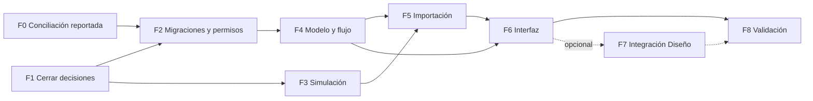

# Roadmap técnico: solicitudes de Diseño

**Estado (2026-10-26):** implementación local lista para revisión; el build, TypeScript y las pruebas focalizadas pasan. El usuario reporta ambas migraciones aplicadas en Supabase; esta sesión no consultó la base ni verificó el historial remoto. La importación real y la validación interactiva con cuentas de usuario siguen pendientes.

Documentos relacionados: [`plan-solicitudes-diseno.md`](./plan-solicitudes-diseno.md) (funcional y registro de decisiones), [`plan-datos-solicitudes-diseno.md`](./plan-datos-solicitudes-diseno.md) (datos y seguridad), [`plan-importacion-solicitudes-diseno.md`](./plan-importacion-solicitudes-diseno.md) (mapeo e importación).

## 1. Orden recomendado y cambios respecto al encargo

Se conserva la secuencia F0–F8 del encargo con estos ajustes `[PROPUESTA]`:

| Cambio | Razón |
|---|---|
| F0 y F1 se ejecutan en paralelo | F0 es verificación técnica y F1 es cierre de decisiones con el usuario; no dependen entre sí. |
| F3 (simulación) ocurre antes de F4 y **no necesita tablas** | La simulación trabaja sobre el archivo y exportaciones locales de perfiles; produce un informe que decide catálogos y reglas de entregables antes de fijar migraciones. |
| La revisión de duplicados e identidades ambiguas se hace sobre el informe de simulación antes de F5 | Evita depender de una interfaz que aún no existe. La revisión posterior a la importación se hace en F6. |
| F7 es **condicional** a D-12 | La recomendación es no integrar con la cola de Diseño en el primer despliegue. |

## 2. Fases

| Fase | Contenido | Entrada | Salida (criterio de aceptación) |
|---|---|---|---|
| **F0** Conciliación previa ya reportada | Usar como línea base la conciliación realizada antes de redactar este plan; revisar el historial actualizado en `supabase/migrations/` y los esquemas `docs/supabase-schema-public.md` y `docs/supabase-schema-auth.md`. No repetir `db pull` ni `migration list --linked` salvo que hayan ocurrido cambios remotos desde esa conciliación. Antes de F2, comprobar solo los objetos concretos que afectará la nueva migración | Evidencia local y confirmación del usuario | D-02 se considera resuelta `[REPORTADO]`; cualquier cambio posterior de esquema remoto se identifica antes de migrar. No se ejecuta `db push` a ciegas ni se repara el historial sin comprobar que el esquema existe. |
| **F1** Cierre de especificación | Reflejar las decisiones ya recibidas: modelo independiente, catálogo propio de departamentos, correo del remitente sin vínculo de identidad, zona horaria `America/Caracas`, campos con sufijo `2` separados, alias exactos y desconocidos a revisión, sin borrado físico operativo, entorno Supabase local y menú «Registro» | Este plan revisado y Excel ya inspeccionado | Las decisiones confirmadas están reflejadas en todos los documentos; las propuestas técnicas aún no aprobadas siguen identificadas como tales |
| **F2** Migraciones, permisos y datos | Migraciones base y de soporte implementadas localmente; ambas reportadas como aplicadas por el usuario | F0, F1 | Revisar grants/RLS y conciliar el historial con el estado remoto antes de importar |
| **F3** Simulación del importador | Lector, simulador sin escritura y resumen agregado implementados; simulación del archivo privado ejecutada sin escritura | Excel privado disponible; zona `America/Caracas`, correo remitente y campos adicionales definidos | Revisar informe agregado y advertencias antes de autorizar escritura; no exponer datos personales en el resumen |
| **F4** Modelo y flujo operativo | Esquema, RPC, Server Actions con `authorizeAction`, tipos y UI implementados localmente; migraciones reportadas aplicadas en Supabase. No se verificó la base remota ni se probó Supabase local | F2; confirmar el estado desplegado y probar RLS/RPC si está disponible | Build y TypeScript en verde; falta validar RLS/RPC y flujos con cuentas reales |
| **F5** Importación histórica | CLI real con RPC transaccional exclusiva de `service_role`, simulación y reanudación implementadas; importación productiva aún no ejecutada | F3, F4, migración 002 aplicada y simulación revisada | Segunda ejecución sin registros nuevos; conciliación completa; trazabilidad fila→solicitud verificada |
| **F6** Interfaz de gestión y consulta | Vista `/design/registro` implementada con solicitudes, entregables, historial y datos originales; acciones de escritura protegidas por permiso. Todos los usuarios autenticados pueden leer los originales, incluido el correo (D-08/D-14). La importación es separada y aditiva | F4, F5; falta validar con cuentas reales | Flujos funcionales, accesibilidad y estados de carga/error/vacío; pruebas T-U1 a T-U4 sin cambios en las vistas existentes salvo el ítem de menú |
| **F7** Integración con Diseño (condicional) | Adaptador y RPC propios si D-12 lo aprueba | D-12 aprobada, F4, F6 | Cola sin duplicados; solicitudes `HISTORICA` ausentes; pruebas de integración de §7 |
| **F8** Pruebas con usuarios y validación de producción | Pruebas con Diseño; Social Media solo si una decisión futura cambia D-08; verificación de grants y RLS; revisión de logs | F4–F6 (y F7 si aplica) | Pruebas positivas y negativas con cuentas reales; matriz de permisos verificada contra el esquema conciliado y cualquier cambio remoto posterior |

## 3. Dependencias externas y bloqueos conocidos

| Dependencia | Afecta | Estado |
|---|---|---|
| Conciliación previa de Supabase | F0 | Realizada antes de redactar el plan, según confirmación del usuario; los esquemas público/auth e historial están en el repositorio |
| Archivo original de la hoja | F3 | Se inspeccionó la copia proporcionada; se retiró del repositorio por contener datos personales. Para repetir F3, el operador debe facilitar una copia privada fuera del repositorio. Zona horaria, campos con sufijo `2` y correo del remitente están confirmados; quedan pruebas de tokenización, alias y mapeos |
| Supabase local con Docker y CLI | F4, F5 | Elegido por el usuario; Docker y su daemon responden en este entorno, pero el binario Supabase CLI no está instalado. Resolver la CLI/configuración local al iniciar F4; no afecta la simulación F3. |
| Respuestas del usuario a D-07, D-08, D-09, D-10, D-14, D-17, D-20 y D-22 | F1 | Recibidas y registradas el 2026-10-26 |
| Estado remoto de migraciones/esquemas | F0/F2 | Conciliación ya realizada al redactar el plan, según confirmación del usuario; usar la línea base local y revisar cambios posteriores solo si los hubiera |
| Dos lockfiles (`package-lock.json` y `pnpm-lock.yaml`) | F4 | Detectados en la raíz `[REPO]`; confirmar el gestor vigente antes de instalar dependencias |

## 4. Riesgos

| Riesgo | Impacto | Mitigación |
|---|---|---|
| Cambios remotos posteriores a la conciliación reportada | Migraciones que fallan o duplican objetos | Revisar solo los objetos afectados por la nueva migración y no ejecutar `db push` a ciegas |
| Tablas nuevas expuestas por la API (`auto_expose_new_tables` sin definir) | Fuga de datos | RLS + `REVOKE` en la misma transacción; verificar en remoto (datos §12.9) |
| Datos personales (nombres, correos) en la importación | Exposición | El Excel fuente no se versiona; no crear copias en el repositorio, no mostrar datos personales en informes generales y restringir los originales mediante permiso separado |
| Interpretación errónea de «¿Cuántas piezas?» o formatos | Entregables inventados | Reglas conservadoras E1–E11; cero entregables ante ambigüedad; confirmar con datos reales en F3 |
| Hoja con inconsistencias (bases distintas, estados sin fecha de término) | Conciliación que no cuadra | Recalcular todo sobre el archivo; advertencias sin corrección |
| Zona horaria de la marca temporal incorrecta | Fechas desplazadas | D-15; informe de simulación con ejemplos |
| Permisos demasiado amplios | Acceso indebido | Matriz explícita; `admin` sin herencia; pruebas negativas |
| Cambio de `DesignSource` rompe la cola | Regresión en Diseño | F7 opcional; pruebas de no regresión de `publicaciones`, `pendientes_tienda`, `eventos` |
| La implementación altera la UI ya aplicada (menús, cola, historial, ficha, modales de Grid) | Regresión visual en vistas revisadas | Lista de archivos intocables y archivo único editable (`design/shell.tsx`); línea base de capturas; revisión de `git diff --stat` en cada entrega (plan §11.1) |
| Nombre del ítem de menú choca con «Solicitudes» | Confusión del usuario | Nombre distinto, «Registro», y ruta `/design/registro` fijados en D-21 |
| `publicacion_estatus_historial` sin trigger de inmutabilidad | Precedente débil | No se toma como modelo; trigger propio en el historial nuevo |
| Reintentos de PostgREST por `40001` | Bucles | Conflictos de versión con `PT409` |
| Enlaces de «Imagen referencial» maliciosos o privados | Seguridad y confianza | Solo texto/URL `http(s)`; sin descarga ni previsualización |

## 5. Entregables por fase

F0: informe de conciliación y esquema regenerado. F1: registro de decisiones cerrado. F2: migraciones revisadas (sin ejecutar), matriz de permisos aprobada. F3: herramienta de simulación e informe. F4: migraciones aplicadas en pruebas, RPC, acciones, tipos. F5: importador, informe de conciliación. F6: vistas. F7: adaptador (si aplica). F8: informe de pruebas con usuarios.

## 6. Primera fase técnica recomendada

**F0, junto con F1.** Es la única que no requiere decidir nada nuevo y desbloquea F2. Tareas concretas: (1) `supabase migration list --linked`; (2) `supabase db pull` en una copia y comparar; (3) registrar el valor efectivo de `auto_expose_new_tables`; (4) listar `app_permissions` y `role_permissions` reales; (5) en paralelo, enviar al usuario las decisiones D-07, D-08, D-09, D-10 y D-17.

## 7. Plan de pruebas

Leyenda: **[D]** se puede diseñar ahora; **[I]** solo se puede ejecutar tras implementar. Herramientas existentes en el repositorio `[REPO]`: Jest (`npm test`, `npm run test:integration`) y Playwright (`npm run test:e2e`, `e2e/`); las pruebas SQL de permisos y RLS requieren un entorno de base de datos de pruebas.

### 7.1 Datos e importación

| # | Caso | Resultado esperado | Tipo |
|---|---|---|---|
| T-D1 | Fila completa y válida | `IMPORTADA`; solicitud, entregables `HISTORICO`, un evento `IMPORTACION` | D (unidad) / I |
| T-D2 | Fila con campos sin equivalencia | `IMPORTADA_PARCIAL`; originales intactos; advertencia | D |
| T-D3 | Fila sin título ni marca temporal (huérfana con «Terminado») | `EXCLUIDA_SIN_IDENTIDAD_MINIMA`; no crea solicitud; queda en el registro | D |
| T-D4 | Solo título o solo marca temporal | `PENDIENTE_REVISION` | D |
| T-D5 | Fila vacía | `EXCLUIDA_VACIA` | D |
| T-D6 | Fecha inválida, número serial, texto con formato distinto | Normalizada `NULL` + original + advertencia | D |
| T-D7 | Fecha de entrega anterior a la marca temporal | Se conserva; advertencia | D |
| T-D8 | Solicitante o diseñador sin cuenta | Nombre conservado; sin vínculo; fila válida | D |
| T-D9 | Nombre que coincide con dos perfiles / correo y nombre apuntan a usuarios distintos | `IDENTIDAD_AMBIGUA`; sin vínculo | D |
| T-D10 | «1 diseño para diferentes formatos…», «1 diseño para varias fotos o videos…», «1 diseño para un formato» | Reglas E5, E6, E7 | D |
| T-D11 | Cantidad en texto libre sin número | `cantidad_piezas = NULL`; texto conservado | D |
| T-D12 | Varios formatos inequívocos / ambiguos | Agrupación o cero entregables según E2, E9 | D |
| T-D13 | «Digital e impreso» con y sin tokens en ambas familias | E8 | D |
| T-D14 | Dos filas con el mismo título y solicitante en pocos días | Ambas importadas; `POSIBLE_DUPLICADO` | D |
| T-D15 | Repetir el mismo lote | Cero registros nuevos | D (simulación) / I |
| T-D16 | Cambiar el archivo y reimportar | Fila idéntica → `OMITIDA_YA_IMPORTADA`; si cambia cualquier celda, cambia la huella y pasa a revisión de duplicados; nunca se actualiza ni sobrescribe la solicitud anterior, sea manual o importada | D / I |
| T-D17 | Fallo forzado a mitad del lote y reanudación | Sin duplicados; lote completa | I |
| T-D18 | Conciliación: suma de resultados = filas de origen; solicitudes = importadas + parciales; trazabilidad fila↔solicitud 1:1 | Todos los controles de import §13 | D / I |
| T-D19 | Distribución de `estado_historico_original` = la del archivo; cero transiciones de estado | Verificado | I |
| T-D20 | Estructura inválida (falta una columna, encabezado distinto) | Falla explícita antes de procesar | D |
| T-D21 | Revertir lote sin actividad posterior | El lote se deshace atómicamente; solicitud y entregables desaparecen; filas, originales y UUID revertidos permanecen auditables | I |
| T-D22 | Revertir lote con una solicitud editada o con actividad posterior | La operación falla sin cambios y explica qué registro impide revertir | I |

### 7.2 Flujo funcional

| # | Caso | Tipo |
|---|---|---|
| T-F1 | Crear solicitud sin publicación ni entregables | I |
| T-F2 | Guardar una referencia manual a una publicación u otra entidad | I |
| T-F3 | Solicitud con varios entregables; completar uno y verificar `EN_CURSO` | I |
| T-F4 | Cancelación con motivo; entregables abiertos cancelados y completados intactos | I |
| T-F5 | Reabrir una `HISTORICA` con motivo | I |
| T-F6 | Cambio de responsable: fila `ASIGNACION` con anterior, nuevo, actor y fecha; solicitante intacto | I |
| T-F7 | Consultar historial y datos originales según permisos | I |
| T-F8 | Solicitud histórica no genera ticket activo de Diseño | I |
| T-F9 | Conflicto de versión devuelve HTTP 409 (`PT409`) y no se reintenta | I |

### 7.3 Seguridad

| # | Caso | Tipo |
|---|---|---|
| T-S1 | Usuario con permiso lee y escribe lo previsto | I |
| T-S2 | Usuario autenticado **sin** permiso: sin lectura por tabla ni RPC | I |
| T-S3 | Usuario `admin` sin permisos explícitos: sin acceso | I |
| T-S4 | `UPDATE` o `DELETE` sobre el historial, incluso con `service_role` | I |
| T-S5 | Acceso a lotes y filas de importación sin `import.read`: denegado; con `import.read` sí | I |
| T-S6 | Llamada directa a una RPC de escritura sin permiso: error `42501` | I |
| T-S7 | Intento de `INSERT` directo a las tablas desde el cliente (`authenticated`) | I |
| T-S8 | El correo del solicitante no aparece en listados ni respuestas de cola | I |
| T-S9 | Si hay integración: la RPC de cola exige ambos permisos y no devuelve datos de importación | I (F7) |
| T-S10 | Diseñar las pruebas SQL (roles simulados) y los casos de denegación antes de F4 | D |

### 7.4 Integración

| # | Caso | Tipo |
|---|---|---|
| T-I1 | Crear solicitudes y guardar referencias manuales no cambia estados ni historial de `publicaciones`, `pendientes_tienda` ni `eventos` | I |
| T-I2 | La cola de Diseño (`/design/publications`) no muestra solicitudes del módulo en v1 | I |
| T-I3 | Con integración: sin duplicados en la cola, cancelación coherente, historial persistente, permisos por origen | I (F7) |
| T-I4 | Regresión de los adaptadores `adaptPublication`, `adaptInternal`, `adaptEvent` (`src/lib/designRequests.ts`) | I |

### 7.5 Interfaz (no regresión)

| # | Caso | Tipo |
|---|---|---|
| T-U1 | Capturas de la cola, el historial y la ficha de Diseño, y del menú de Social Media, antes y después: sin diferencias salvo el ítem de menú nuevo (Playwright está configurado, pero no hay pruebas de capturas hoy; la línea base se crea en F6) | I |
| T-U2 | `git diff --stat` de la rama de F6 solo muestra archivos nuevos y `design/shell.tsx` (más el menú de otro rol si D-08 lo aprueba) | I |
| T-U3 | El módulo no abre modales ni navega a una ficha aparte | I |
| T-U4 | Un rol sin permiso no ve el ítem de menú y la ruta responde como no encontrada (`requirePermission` usa `notFound()` `[REPO]`) | I |

## 8. Verificaciones remotas pendientes

Resumen; la lista completa está en [`plan-datos-solicitudes-diseno.md` §12](./plan-datos-solicitudes-diseno.md#12-objetos-remotos-que-requieren-comprobación-antes-de-crear-migraciones). Ninguna se ha ejecutado.

## 9. Revisión cruzada de la documentación

Revisión del 2026-10-25 contra el commit `22d2fb1` de `main`. Método: un script de comprobación (no versionado) valida enlaces relativos, anclas, rutas y nombres de migraciones citados, y que los identificadores de funciones SQL y de TypeScript mencionados existan en el repositorio; el resto es lectura cruzada manual. El script **solo comprueba referencias**, no la corrección del diseño.

| # | Criterio del encargo | Resultado |
|---|---|---|
| 1 | Arquitectura coherente entre documentos | Cumplido tras corregir una contradicción sobre la reversión de lotes (ahora D-20) |
| 2 | Decisiones confirmadas sin alteraciones | Cumplido; resumidas en el registro §13.1 |
| 3 | Propuestas diferenciadas | Cumplido por etiquetas `[CONFIRMADA]`/`[PROPUESTA]` y registro de decisiones |
| 4 | Compatibilidad con entidades existentes | Cumplido; ninguna entidad existente se modifica en v1 (datos §11) |
| 5 | Permisos y RLS verificables | D-07 a D-09 confirmadas; la propuesta de permisos/RLS aún debe convertirse en migraciones y validarse con pruebas negativas en Supabase local |
| 6 | Importación idempotente y auditable | Cumplido a nivel de diseño (import §11, §13) |
| 7 | Datos originales sin pérdida | Cumplido: doble copia (`datos_originales` y pares `*_original`) |
| 8 | Estados históricos sin transiciones ficticias | Cumplido: `HISTORICA`/`HISTORICO`, un solo evento `IMPORTACION` |
| 9 | Fases, dependencias y criterios | Cumplido (§2–§3) |
| 10 | Riesgos y verificaciones remotas identificados | Cumplido (§4, datos §12); ninguna verificación ejecutada |
| 11 | Sin cambios en implementación ni datos | Verificado durante esta actualización: solo documentación modificada; no se cambió código ni se escribieron datos en Supabase |
| 12 | Referencias internas coherentes | Cumplido según el script (0 problemas) y la comprobación de los D-xx citados contra el registro |
| 13 | Índice actualizado solo si es necesario | Se añadieron cuatro filas a `docs/design/README.md`; no se tocó otra documentación |
| 14 | Otro desarrollador puede empezar sin reconstruir decisiones | **Parcial:** las decisiones del usuario y el archivo están revisados; falta implementar y aprobar la especificación técnica (incluidas las propuestas D-05, D-06 y D-16), ejecutar F3, verificar D-20 en pruebas locales e instalar/verificar Supabase CLI para F4/F5 |

**Limitaciones de la auditoría.** El usuario confirma que la conciliación de Supabase se hizo antes de redactar el plan y que el historial y los esquemas público/auth actualizados están en el repositorio. No se consultó Supabase directamente durante esta revisión, por lo que el estado remoto se conserva como `[REPORTADO]`, no `[REMOTO]`. El Excel está presente en `docs/` y fue inspeccionado estructuralmente y mediante conteos agregados; todavía falta ejecutar F3 para validar el mapeo fila por fila y aprobar el informe. Otras observaciones de repositorio: `inventory_import_batches` no se crea en una migración (aparece en `supabase/imports/20261013_control_inventario_mercadeo.sql`); `docs/supabase-db-migration.md` §5 describe la política RLS permisiva como etapa anterior, sustituida por `202610060001_role_permission_policies.sql`; `publicacion_estatus_historial` no tiene trigger de inmutabilidad.
